# Architecture

[繁體中文](ARCHITECTURE.zh-tw.md)

This document is for engineers who operate, extend or integrate Agent Memory. It covers the moving parts, how a request is authorized, how a conversation becomes long-term memory, and where each piece lives in the code. For endpoints and payloads see [API.md](API.md). For deployment see [REMOTE-CLIENTS.md](REMOTE-CLIENTS.md), [UPGRADE.md](UPGRADE.md) and [UNINSTALL.md](UNINSTALL.md).

## Contents

1. [System overview](#1-system-overview)
2. [Code layout (Clean Architecture)](#2-code-layout-clean-architecture)
3. [Identity and authorization](#3-identity-and-authorization)
4. [Memory model and pipeline](#4-memory-model-and-pipeline)
5. [Recall](#5-recall)
6. [The `amem` client and integrations](#6-the-amem-client-and-integrations)
7. [Monitor Panel](#7-monitor-panel)
8. [Backends and deployment topologies](#8-backends-and-deployment-topologies)
9. [Upgrade and removal](#9-upgrade-and-removal)
10. [Design notes](#10-design-notes)

## 1. System overview

Agent Memory is a self-hosted memory service for AI agents. Agents send their conversations, and the service distills them in the background into facts, scenes and a persona, then hands the relevant parts back before the next turn. No vendor cloud product is required. Storage is SQLite or Postgres, and the LLM is any OpenAI-compatible endpoint or a local CLI (Claude Code, Antigravity, Codex).

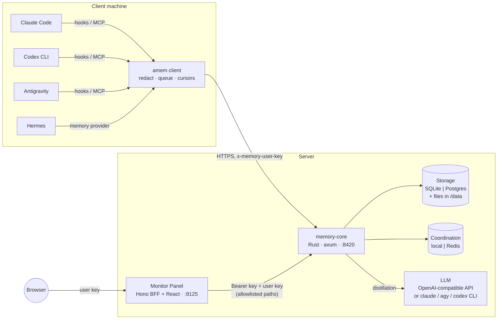

| Component | Role | Code |
| --- | --- | --- |
| memory-core | HTTP API, authorization, memory pipeline, recall | `crates/memory-*` |
| amem | Client binary used by every integration: recall, capture, offline queue, MCP server | `crates/memory-client` |
| Integrations | Thin host adapters that call `amem` | `clients/claude-code`, `clients/codex`, `clients/antigravity`, `clients/hermes` |
| Monitor Panel | Admin and inspection UI. The BFF holds the server API key; the browser holds only a user key | `panel/server`, `panel/web` |
| Scripts | Install, upgrade and removal for operators | `install.sh`, `upgrade.sh`, `uninstall.sh` |

## 2. Code layout (Clean Architecture)

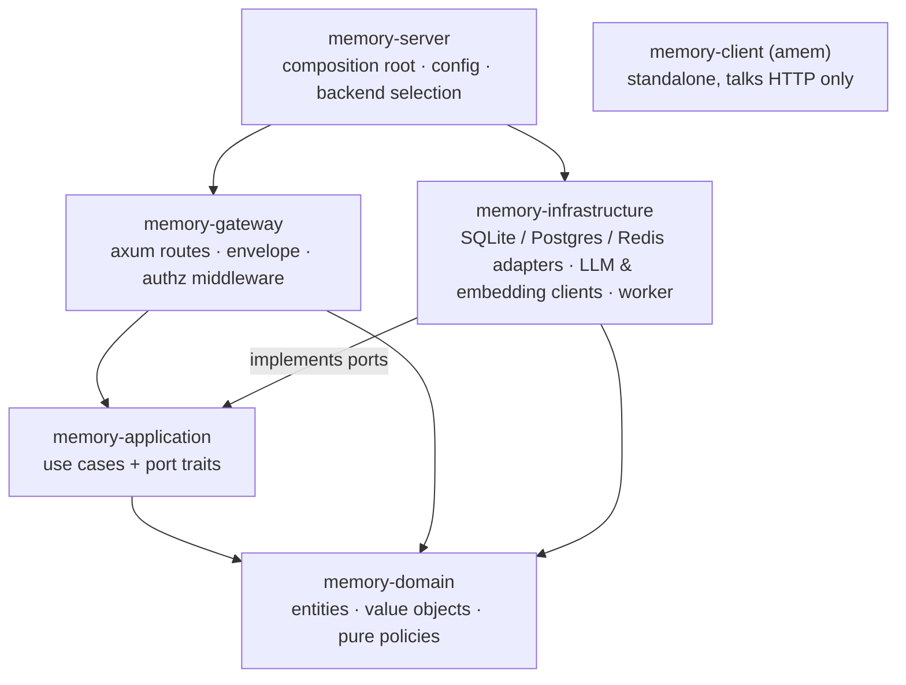

Dependencies point inward only. `memory-domain` does no I/O. `memory-application` defines the ports (traits) that `memory-infrastructure` implements. The gateway calls use cases but never touches a database. `memory-server` is the only crate that knows which adapters are wired, chosen in `crates/memory-server/src/backends.rs`. `memory-client` shares no code with the server; its only contract is the HTTP API.

Where to look:

| Concern | Domain (rules) | Application (use cases) | Gateway / infrastructure |
| --- | --- | --- | --- |
| Scope and isolation | `scope.rs` | — | `gateway/src/context.rs` |
| Data-plane authorization | `meta/memory_access.rs` | `meta/data_access.rs` | `gateway/src/authz.rs` |
| Users, teams, agents, keys, ACL | `meta.rs`, `meta/access.rs` | `meta/*.rs` | `handlers/meta.rs`, `*/meta_store.rs` |
| L0–L3 memory | `memory.rs`, `profile.rs` | `memory/*` | `*/memory_store.rs` |
| Pipeline | `pipeline.rs` | `pipeline/*` | `infrastructure/.../worker.rs`, scheduler |
| Recall | `retrieval.rs` | `memory/recall*` | FTS5 / tsvector, vector index |
| Skills | `skill.rs` | `skill/*` | `handlers/skill.rs` |
| Upgrade | — | `migration.rs`, `upgrade.rs` | `handlers/meta.rs` (`internal_*`) |

## 3. Identity and authorization

### Entities

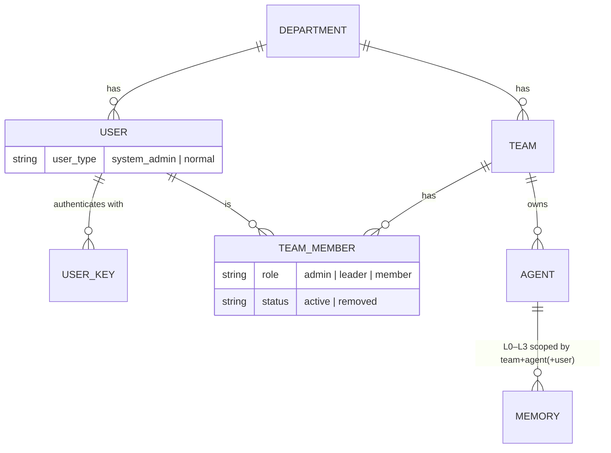

- A **department** (`x-memory-department-id`, default `default`) is a hard boundary. Each has its own SQLite file or Postgres schema.
- A memory **scope** is `team_id / agent_id / user_id (/ task_id)`. L0/L1 are per user. L2 scenes and the L3 persona are per team + agent.
- A **user key** (`sk-mem-…`) identifies one user. Keys can be listed, revoked and expire. The **server API key** (`AGENT_MEMORY_API_KEY`, sent as Bearer) identifies the operator, not a user.

### Two trust zones

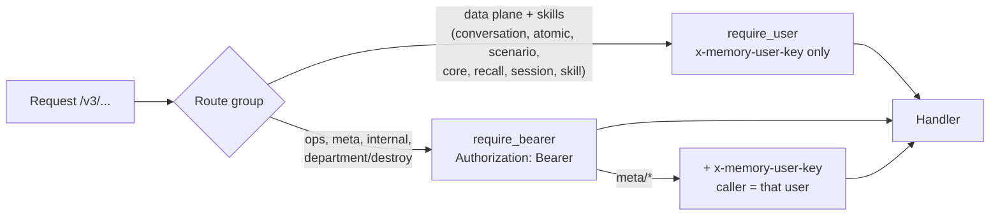

Remote clients therefore never need the server API key. Leaking a user key exposes only that user's memory, in the teams they belong to.

### Data-plane authorization

One middleware (`gateway/src/authz.rs`) runs before every user-scoped handler. It delegates the decision to a pure policy, `authorize_memory_scope` (`memory-domain/src/meta/memory_access.rs`):

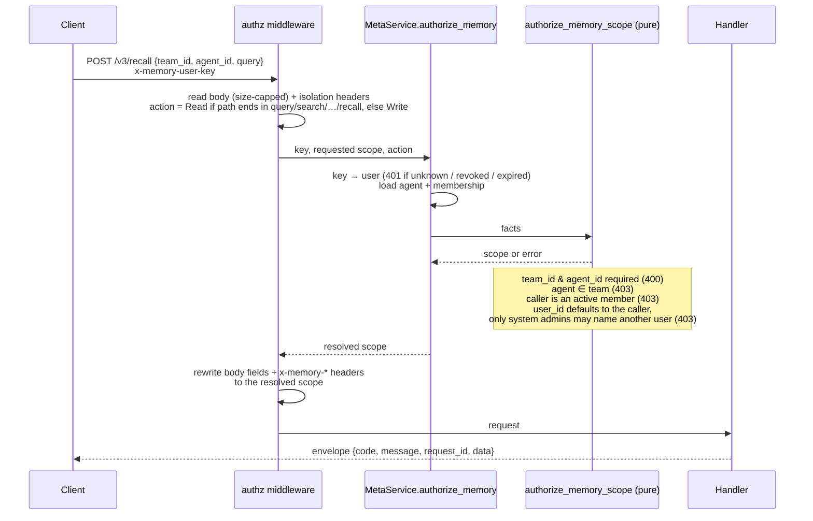

Two properties matter when extending the API:

- **Fail closed.** A route whose last path segment is not a known read suffix is treated as a write.
- **Handlers can't see an unauthorized scope.** The middleware overwrites whatever scope the caller sent, so a new handler inherits isolation without doing anything.

The metadata plane has its own, finer rules (`memory-domain/src/meta/access.rs`). System admins manage everything; team admins manage their team; visibility (`private` / `team` / `restricted` / `agent` / `task`) and ACL allow entries govern assets (deny entries are stored but not applied yet). [COLLABORATION.md](COLLABORATION.md) covers teams, users and agents end to end. The Panel adds a coarser rule on top, described in §7.

## 4. Memory model and pipeline

| Layer | What | Scope | Storage |
| --- | --- | --- | --- |
| L0 conversation | Raw turns as captured (text only) | team / agent / user / session | `conversations` rows |
| L1 atom | Distilled facts: `episodic`, `persona`, `instruction` | team / agent / user | `atoms` rows + full-text + vector index |
| L2 scene | Topic documents (`scene_blocks/*.md`) with heat and summary | team / agent | append-only `scenes` + `scene_versions` |
| L3 persona | One narrative profile (`persona.md`) | team / agent | append-only `persona_versions` |
| Skills | Reusable procedures distilled from tool-heavy turns | team / agent | `skills` + resource files |

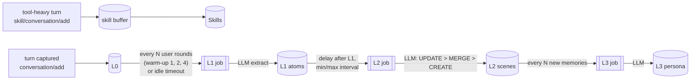

The trigger values come from `config/memory-core.example.yaml` (`memory.pipeline.*`, `memory.persona.triggerEveryN`).

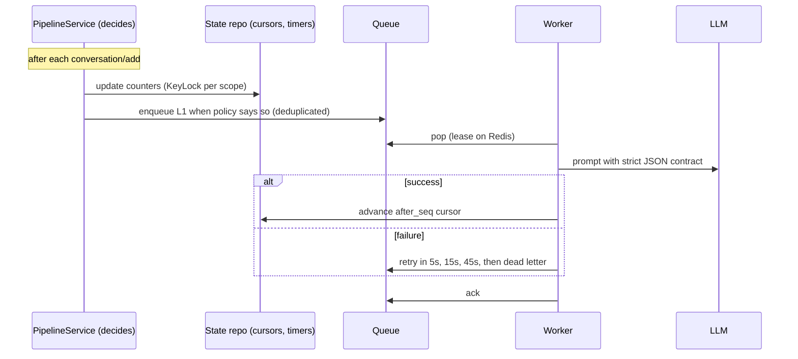

- The **decisions** live in `memory_domain::pipeline` and `PipelineService`. The worker only serializes jobs per session/profile, coalesces duplicates and retries.
- **Cursors** are store-assigned sequence numbers (`after_seq`), never reused. Equal or back-dated timestamps therefore can't skip rows. The upgrade keeps them when it moves data.
- **LLM output** must follow a strict JSON (or markdown) contract and is parsed tolerantly: `<think>` blocks and code fences are accepted. Custom memory prompts are appended inside a guard that keeps the contract. With a CLI provider, memory-core runs `claude`, `agy` or `codex exec` in `/workspace` with the prompt as an argument or on stdin.
- **Status** is visible at `POST /v3/pipeline/status` (queue, worker metrics, per-scope cursors) and in the Panel. Every run that reaches the LLM is logged as `succeeded`, `empty` or `failed` (with its error), and jobs that fail every retry are kept as dead letters that can be redriven ([ops/DISTILLATION.md](ops/DISTILLATION.md)).

## 5. Recall

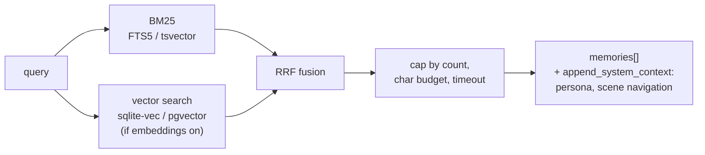

- Documents and queries share one tokenizer: lower-cased Latin words plus overlapping CJK bigrams. Keyword scores are normalized against the best hit, so the threshold doesn't depend on corpus size.
- Without an embedding provider (`AGENT_MEMORY_EMBEDDING_PROVIDER=none`), recall is BM25 only; `strategy` in the response says which was used.
- `append_system_context` is what the integrations inject: `<user-persona>`, `<scene-navigation>`, and a short guide on how to use them.

## 6. The `amem` client and integrations

All integrations call the same binary, so redaction, queueing and the API contract are implemented once.

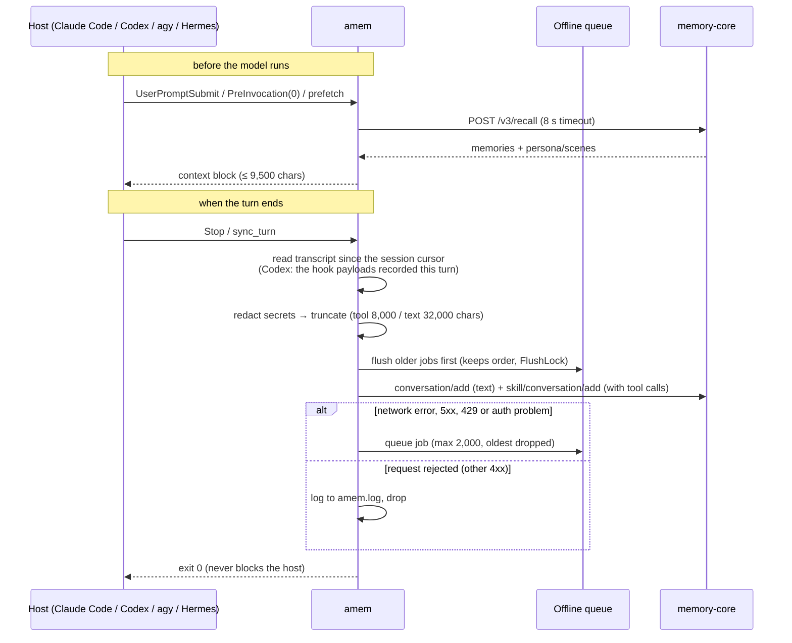

| Piece | Behavior | Code |
| --- | --- | --- |
| Settings | `~/.config/agent-memory/client.json` (0600), written by `amem login`; `AMEM_*` env vars override | `config.rs` |
| Transcripts | Claude Code JSONL, Antigravity steps, Codex hook payloads and OpenAI-style messages are mapped to one model: user/assistant text plus tool_call/tool_result. `<system-reminder>` blocks are stripped | `transcript.rs` |
| Cursors | Per host and session under `~/.local/share/agent-memory/state`, so each Stop sends only new lines | `hooks.rs` |
| Redaction | Regex rules for API keys, tokens, private keys and `password=`-style pairs → `[REDACTED:<kind>]`. Runs before truncation, so a cut can't expose half a secret | `redact.rs` |
| Queue | One JSON file per request in `…/agent-memory/queue`, replayed oldest first; `.flush.lock` (stale after 120 s) prevents double sends | `queue.rs` |
| MCP | stdio server exposing `memory_recall`, so the agent can search on purpose | `mcp.rs` |

Host adapters:

| Host | Recall hook | Capture hook | Install unit |
| --- | --- | --- | --- |
| Claude Code | `SessionStart`, `UserPromptSubmit` | `Stop` | plugin (`.claude-plugin`, `hooks/hooks.json`, `.mcp.json`); settings as `CLAUDE_PLUGIN_OPTION_*` |
| Codex CLI | `UserPromptSubmit` | `Stop`, with the turn assembled from `UserPromptSubmit` + `PostToolUse` payloads (the transcript is not a stable interface) | plugin (`.codex-plugin/plugin.json`, `hooks/hooks.json`, `.mcp.json`) from `.agents/plugins/marketplace.json`; hooks need `/hooks` trust |
| Antigravity | `PreInvocation` with `invocationNum == 0` → `injectSteps` ephemeral message | `Stop` | plugin (`plugin.json`, `hooks.json`, `mcp_config.json`), user or workspace `.agents/plugins` |
| Hermes | `prefetch` | `sync_turn`, one background worker so turns stay ordered | MemoryProvider `agentmemory` in `$HERMES_HOME/plugins` |

## 7. Monitor Panel

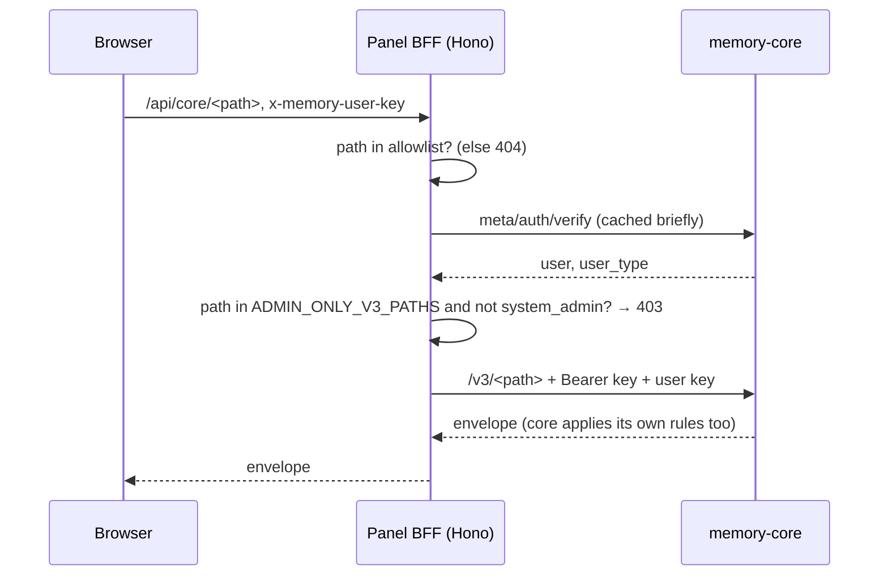

- The **server API key stays on the server** (`panel/server`). The browser only ever holds the user's key.
- The **allowlist** (`panel/server/src/http/allowlist.ts`) keeps the BFF from becoming an open proxy: `internal/*` and `department/destroy` are never reachable.
- **v1 access model:** system admins create and edit users, teams, members and agents. Everyone else gets a read-only view: the L0–L3 tabs still show the data, but the edit and delete actions are hidden.
- `panel/web` is React + Vite: health, layer counts, pipeline status, the memory browser (L0–L3), skills, and metadata (users, teams, members, agents).

## 8. Backends and deployment topologies

| Port group | `sqlite` | `postgres` |
| --- | --- | --- |
| L0–L3, metadata, skills, prompts, logs | one file per department; FTS5 + sqlite-vec `vec0` (brute-force fallback) | one schema per department; tsvector + pgvector HNSW |

| Port group | `local` | `redis` |
| --- | --- | --- |
| Pipeline state | `system.db` | JSON + due ZSETs |
| Job queue | in-process channel | ready list, delayed/processing ZSETs, leases (at-least-once) |
| `KeyLock` | striped async mutexes | `SET NX PX` + renewal |

Files (skill resources and raw session turns) always live under `<data>/departments/<id>/`, whichever storage backend is chosen.

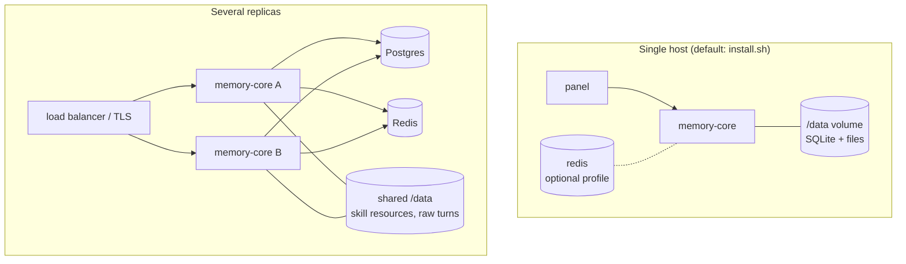

- Docker Compose services: `memory-core`, `memory-panel`, plus `redis` and `postgres` under profiles of the same name. Volumes: `memory-core-data`, `redis-data`, `postgres-data`, `claude-config`, `antigravity-config`, `codex-config` (CLI logins), and the `PROJECT_DIR` bind mount at `/workspace` for CLI LLM providers.
- Images are tagged `memory-core:${MEMORY_IMAGE_TAG}` and `memory-panel:${MEMORY_IMAGE_TAG}` (default `local`). Give each deployment on one host its own tag; otherwise building one overwrites the other's image.
- Multi-node needs `storage.backend = postgres`, `coordination.backend = redis`, and a shared `<data>` volume. An existing SQLite install moves over with `migrate-to-postgres.sh` ([MIGRATE-TO-POSTGRES.md](MIGRATE-TO-POSTGRES.md)).
- Put TLS in front of port 8420 when clients connect over a network; see REMOTE-CLIENTS.md §2.

## 9. Upgrade and removal

Before 0.1.1, writes without a team or agent went to `default` buckets, which the 0.1.1 data plane no longer serves. Operators move that data once with `upgrade.sh`, which drives a single Bearer-only endpoint:

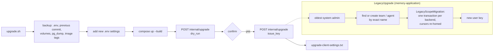

- The upgrade can be repeated safely. An empty legacy bucket is a no-op, and a target agent that already has L2/L3 is refused (409) rather than merged.
- `uninstall.sh client` and `uninstall.sh server` reverse the installation. Data volumes are kept unless `--purge-data` is given.

## 10. Design notes

- **Storage layout.** `<data>/system.db` holds durable pipeline timers for every department. `<data>/departments/<id>/memory.db` holds L0–L3, metadata, skills and logs of one department on SQLite. `<data>/departments/<id>/{sessions,skills}/` holds raw session turns and skill resource files.
- **Append-only profiles.** Every change to an L2 scene or the L3 persona is a new version; nothing rewrites or deletes one except clearing the chat memory. A scene keeps a fixed id across versions, a merge lists the versions it absorbed as parents, and a scene that goes away gets a final `retire` version. The key fields are columns, the body stays markdown, and `attrs` keeps anything else; the markdown files clients see (`scene_blocks/*.md` with a META header, `persona.md` with the Scene Navigation) are rendered from them.
- **Late binding.** Two construction cycles, memory ↔ pipeline and meta ↔ chat-memory, are broken with `OnceLock`-registered collaborators instead of a bidirectional dependency graph.
- **Coordination ports.** `KeyLock` (`ports/coordination.rs`) guards pipeline-state read-modify-write. The worker uses a separate `KeyLock` for per-job exclusivity; otherwise local stripes could make a job wait on itself. `QueueBackend` gives the worker pop / ack / extend / push_later / dead_letter, so delivery semantics belong to the backend.
- **Department destruction** composes each backend's cleanup step (`CompositeLifecycle`): storage (drop file or schema), files, state.
- **No vendor integrations.** Analytics, external task sources and upstream model-group routes are deliberately not provided.
