# 架構

[English](ARCHITECTURE.md)

這份文件寫給要維運、擴充或整合 Agent Memory 的工程師。內容涵蓋各元件、請求如何授權、對話如何變成長期記憶，以及每個部分在程式碼的哪裡。Endpoint 與 payload 請見 [API.zh-tw.md](API.zh-tw.md)；部署請見 [REMOTE-CLIENTS.zh-tw.md](REMOTE-CLIENTS.zh-tw.md)、[UPGRADE.zh-tw.md](UPGRADE.zh-tw.md) 與 [UNINSTALL.zh-tw.md](UNINSTALL.zh-tw.md)。

圖中的元件與程式識別名稱保留英文，方便直接對照程式碼。

## 目錄

1. [系統總覽](#1-系統總覽)
2. [程式結構（Clean Architecture）](#2-程式結構clean-architecture)
3. [身分與授權](#3-身分與授權)
4. [記憶模型與蒸餾管線](#4-記憶模型與蒸餾管線)
5. [召回](#5-召回)
6. [`amem` client 與各整合](#6-amem-client-與各整合)
7. [Monitor Panel](#7-monitor-panel)
8. [後端與部署拓撲](#8-後端與部署拓撲)
9. [升級與移除](#9-升級與移除)
10. [設計細節](#10-設計細節)

## 1. 系統總覽

Agent Memory 是自架的 AI agent 記憶服務。Agent 把對話送進來，服務在背景把它蒸餾成事實、場景和 persona，並在下一個回合開始前把相關的部分送回去。整套服務不依賴任何廠商的雲端產品：儲存用 SQLite 或 Postgres，LLM 可以是任何 OpenAI 相容的 endpoint，或本機的 CLI（Claude Code、Antigravity、Codex）。

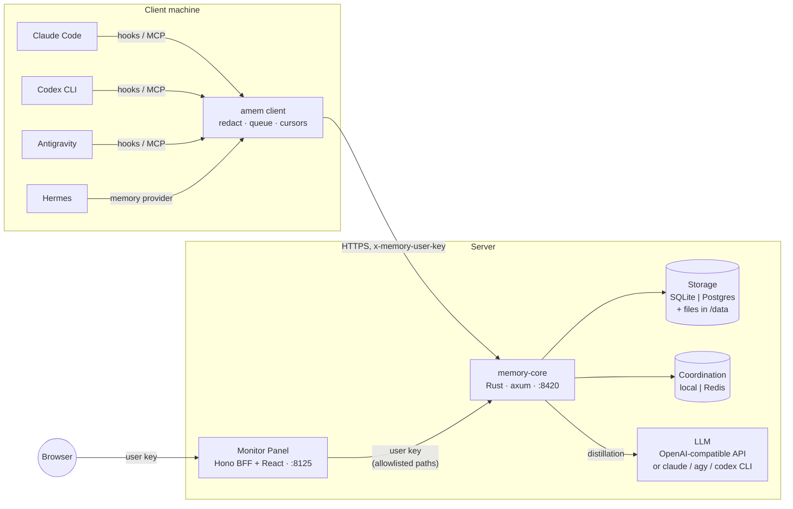

| 元件 | 角色 | 程式碼 |
| --- | --- | --- |
| memory-core | HTTP API、授權、記憶管線、召回 | `crates/memory-*` |
| amem | 所有整合共用的 client 執行檔：召回、寫入、離線佇列、MCP server | `crates/memory-client` |
| 整合 | 呼叫 `amem` 的輕量 host adapter | `clients/claude-code`、`clients/codex`、`clients/antigravity`、`clients/hermes` |
| Monitor Panel | 管理與檢視介面。BFF 只轉送登入使用者的 user key，不持有伺服器 API key | `panel/server`、`panel/web` |
| Scripts | 給維運人員的安裝、升級、移除工具 | `install.sh`、`upgrade.sh`、`uninstall.sh` |

## 2. 程式結構（Clean Architecture）

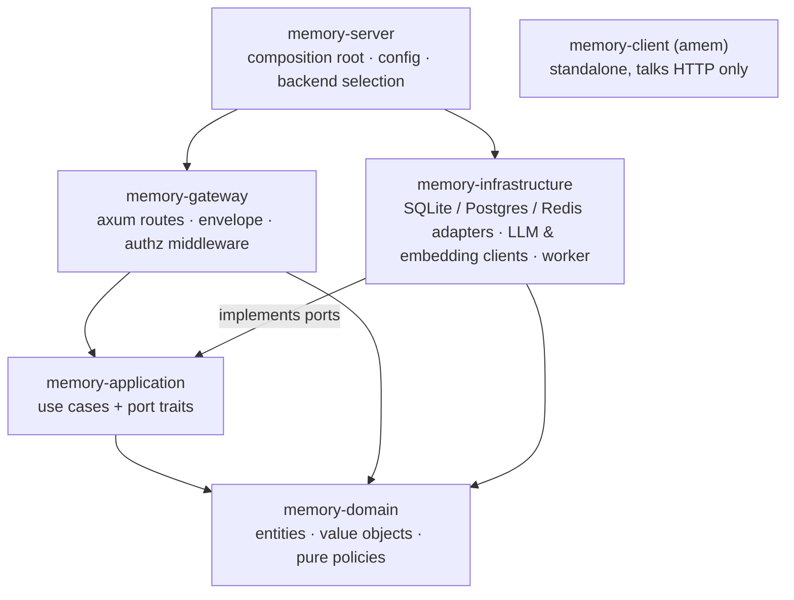

相依方向只往內：
- `memory-domain` 不做任何 I/O。
- `memory-application` 定義 port（trait），由 `memory-infrastructure` 實作。
- gateway 只呼叫 use case，從不直接碰資料庫。
- 只有 `memory-server` 知道接上的是哪些 adapter，選擇集中在 `crates/memory-server/src/backends.rs`。
- `memory-client` 與 server 只共用 `memory-redact`（`crates/memory-client/redact`），讓兩邊用同一套規則遮蔽機密；除此之外，兩者之間唯一的契約是 HTTP API。

去哪裡找程式碼：

| 主題 | Domain（規則） | Application（use case） | Gateway / infrastructure |
| --- | --- | --- | --- |
| 範圍與隔離 | `scope.rs` | — | `gateway/src/context.rs` |
| 資料平面授權 | `meta/memory_access.rs` | `meta/data_access.rs` | `gateway/src/authz.rs` |
| 使用者、team、agent、key、ACL | `meta.rs`、`meta/access.rs` | `meta/*.rs` | `handlers/meta.rs`、`*/meta_store.rs` |
| L0–L3 記憶 | `memory.rs`、`profile.rs` | `memory/*` | `*/memory_store.rs` |
| 蒸餾管線 | `pipeline.rs` | `pipeline/*` | `infrastructure/.../worker.rs`、scheduler |
| 召回 | `retrieval.rs` | `memory/recall*` | FTS5 / tsvector、向量索引 |
| Skills | `skill.rs` | `skill/*` | `handlers/skill.rs` |
| 升級 | — | `migration.rs`、`upgrade.rs` | `handlers/meta.rs`（`internal_*`） |

## 3. 身分與授權

### 實體

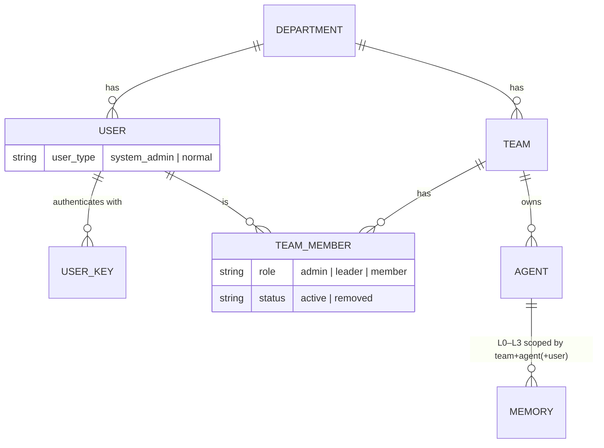

- **部門**（`x-memory-department-id`，預設 `default`）是硬性的邊界，各自有獨立的 SQLite 檔或 Postgres schema，由 `init-admin` 建立。
- 記憶的**範圍（scope）**是 `team_id / agent_id / user_id（/ task_id）`。L0/L1 以使用者劃分；L2 場景與 L3 persona 以 team + agent 劃分。
- **User key**（`sk-mem-…`）代表一位使用者，可以列出、撤銷，也會過期。**伺服器 API key**（`AGENT_MEMORY_API_KEY`，以 Bearer 傳送）代表維運人員，不代表任何使用者。

### 三個信任區

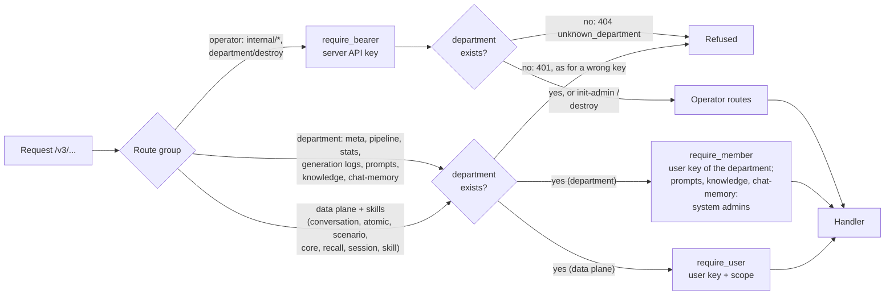

因此遠端 client、部門管理員和 Panel 都不需要伺服器 API key。它只能開啟營運者路由：初始化（`init-admin`）、升級、`department/destroy`，以及 `memory-server generations`／`dead-letters` 看整個部門的檢視。user key 只在自己的部門有效，所以一個部門的管理員管不到另一個部門。

**請把伺服器 API key 當成 root 憑證保管。** 持有它的人可以替新部門建立第一位管理員（`init-admin`）、替部門的系統管理員發一把新 key（`internal/upgrade` 加上 `issue_key`，限於還有 legacy 資料、或設了 `AGENT_MEMORY_ALLOW_KEY_RECOVERY=true` 時）、列出部門的使用者、讀取每個部門的 dead letter、生成紀錄與憑證稽核紀錄，以及刪除部門。它只該留在營運者手上，不要放進部門管理員執行的腳本；如果曾經交給別人，請更換。

**憑證會被檢查、計數並記錄。** User key 以 SHA-256 雜湊儲存。每一次被拒絕的憑證都依 client 位址計算（只採信 `AGENT_MEMORY_TRUSTED_PROXIES` 送來的 `X-Forwarded-For`）：15 分鐘內從第 5 次起延後回應，第 20 次讓這個位址被擋 15 分鐘（429）。拒絕、封鎖以及用伺服器 API key 發出的 key 都寫進部門之外的稽核紀錄；系統管理員看自己部門的，營運者看全部（[API](API.zh-tw.md#憑證稽核紀錄)）。

User key 外洩時，影響範圍只有該使用者在其部門裡能做的事。

部門的儲存空間是在第一次使用時建立的，所以兩個信任區都會先確認部門是否存在（`DepartmentDirectory`：SQLite 檔，或 Postgres 的登記資料列），確認時不會建立它。在 Postgres 上每個請求都會查登記表，所以一台機器刪除部門後，其他機器立刻就會把它當成不存在。只有 `init-admin` 會建立部門，儲存層本身也不會開啟其他部門：不論是請求還是背景工作，用到不存在的部門都會得到 `unknown_department`，而不會建立它。worker 在每個 job 執行前也會確認（同時清掉這台機器過期的資訊），部門已不存在的 job 直接丟棄，不重試、不進 dead letter；部門被刪除後才失敗的 job 也一樣丟棄。`department/destroy` 會刪除該部門的 dead letter；在 SQLite 上，它會在持有 pool 鎖的期間一次完成「移出 pool」與「把目錄搬開」，中間沒有任何操作能重新開啟它。對不存在的部門，`auth/verify` 回 `valid: false`，資料面的回應和 user key 錯誤時相同，所以回應內容看不出部門是否存在。回應時間則看得出來：不存在的部門查完登記表就被拒絕，存在的部門配上錯誤的 key 還要再查一次 key。部門名稱不視為機密，所以接受這一點。

### 資料平面授權

每個使用者範圍的 handler 之前，都會先經過同一個 middleware（`gateway/src/authz.rs`）。它把判斷交給純函式政策 `authorize_memory_scope`（`memory-domain/src/meta/memory_access.rs`）：

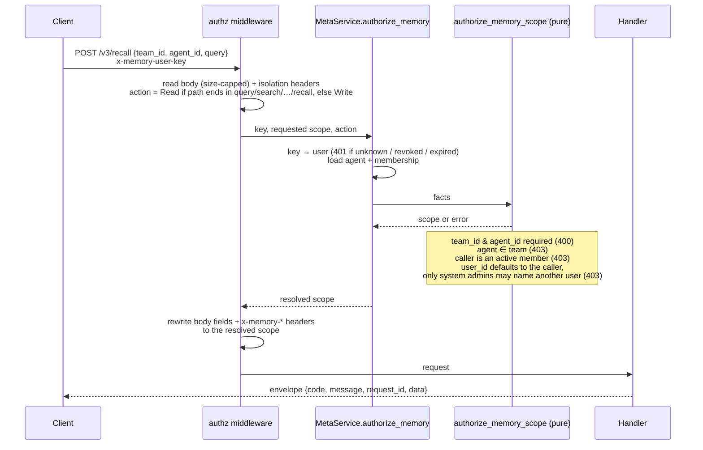

擴充 API 時要注意兩件事：

- **預設拒絕（fail closed）**：路徑最後一段不在已知的讀取字尾清單中，就一律當成寫入。
- **Handler 看不到未授權的範圍**：middleware 會覆寫呼叫端送來的範圍，所以新增的 handler 不用做任何事就自動有隔離。

Metadata 平面有自己更細的規則（`memory-domain/src/meta/access.rs`）：系統管理者可以管理所有東西，team admin 管理自己的 team；asset 則由可見度（`private` / `team` / `restricted` / `agent` / `task`）和 ACL 的 allow 條目決定（deny 條目會儲存但目前不會套用）。團隊、使用者與 agent 的完整說明見 [COLLABORATION.zh-tw.md](COLLABORATION.zh-tw.md)。Panel 在這之上再加一層較粗的規則，見 §7。

## 4. 記憶模型與蒸餾管線

| 層 | 內容 | 範圍 | 儲存 |
| --- | --- | --- | --- |
| L0 對話 | 寫入時的原始回合（只有文字） | team / agent / user / session | `conversations` 資料列 |
| L1 atom | 蒸餾出的事實：`episodic`、`persona`、`instruction` | team / agent / user | `atoms` 資料列 + 全文與向量索引 |
| L2 場景 | 主題文件（`scene_blocks/*.md`），帶熱度與摘要 | team / agent | 只追加的 `scenes` + `scene_versions` |
| L3 persona | 一份敘事式使用者輪廓（`persona.md`） | team / agent | 只追加的 `persona_versions` |
| Skills | 從大量使用工具的回合蒸餾出的可重用流程 | team / agent | `skills` + 資源檔 |

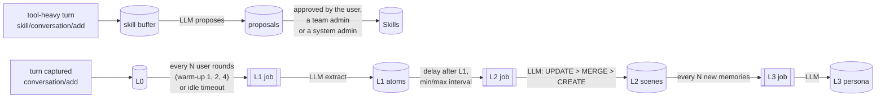

**Skill 萃取只提案，由人決定。** 大量使用工具的回合裡有網頁、檔案和指令輸出，任何人都能在裡面寫指令。所以模型拿到的是一份 JSON 物件（它可以修改的該 agent 的 skill、主 agent 的 hint，以及封存的對話；裡面的內容無法結束資料區，也無法冒充指示），只能修改提供給它看的、該 agent 的 skill（最多 20 個：超過時，先挑搜尋結果中與這段對話最相關的，再補上最近的），而且它建立或修改的內容都會先成為提案（`skill/proposal/*`、Panel 的 Skills 頁），等對話的使用者本人（限於他能使用的 agent）、該 team 的 admin，或系統管理員核准後才生效。誰能審核依記憶的規則判斷（`authorize_proposal_review`，與 `authorize_memory_scope` 放在一起），因為提案是從某人的對話萃取出來的：能看營運狀態的 team leader 不是審核者，私人 agent 的提案只屬於它的擁有者與 team admin。規則依審核當下的 agent 狀態判斷，所以已封存的 agent 沒有人能決定。同一個 task 的決定會持有一把鎖（`skill-proposal:<部門>:<task>`），兩個決定同時進來也不會互相覆蓋。核准時會確認 skill 在提案之後沒有被改過。提案和其他寫入一樣，存下前會先遮罩；未決定的提案會在 `skill.extraction.proposalTtlDays`（預設 30 天，`AGENT_MEMORY_SKILL_PROPOSAL_TTL_DAYS`，0 表示永不過期）之後過期。`skill.extraction.requireApproval: false`（`AGENT_MEMORY_SKILL_REQUIRE_APPROVAL=false`）會像 0.4.2 之前一樣直接套用，另外兩項檢查仍然有效。

觸發參數來自 `config/memory-core.example.yaml`（`memory.pipeline.*`、`memory.persona.triggerEveryN`）。

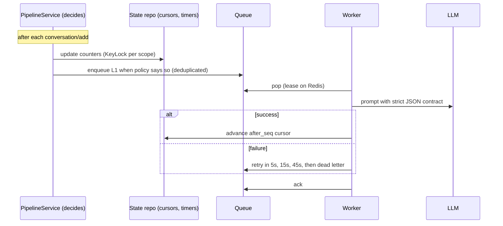

- **決策**放在 `memory_domain::pipeline` 和 `PipelineService`。Worker 只負責依 session/profile 串行執行 job、合併重複的 job，以及重試。
- **游標**是儲存層配發、不會重複使用的序號（`after_seq`）。時間戳相同或倒填都不會漏掉資料。升級搬移資料時會保留游標。
- **LLM 輸出**必須符合嚴格的 JSON（或 markdown）格式，解析時則相對寬鬆，能處理 `<think>` 區塊和 code fence。自訂的 memory prompt 會附加在保護格式的框架內。若 LLM 是 CLI，memory-core 會在 `/workspace` 執行 `claude`、`agy` 或 `codex exec`，prompt 以參數或 stdin 傳入。
- **狀態**可以從 `POST /v3/pipeline/status`（佇列、worker 指標、各範圍的游標）和 Panel 查看。每一次呼叫到 LLM 的執行，都會記錄為 `succeeded`、`empty` 或 `failed`（附錯誤訊息）；每次重試都失敗的 job 會保留為 dead letter，之後可以重跑（[ops/DISTILLATION.zh-tw.md](ops/DISTILLATION.zh-tw.md)）。

## 5. 召回

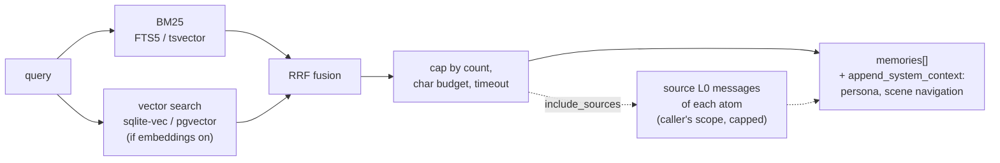

- 文件和查詢共用同一個 tokenizer：小寫的拉丁字詞，加上重疊的 CJK bigram。關鍵字分數以最佳結果為基準正規化，所以門檻值不受資料量影響。
- 沒有 embedding provider 時（`AGENT_MEMORY_EMBEDDING_PROVIDER=none`），召回只用 BM25；回應中的 `strategy` 會標明實際使用的方式。
- 各整合注入的就是 `append_system_context`：`<user-persona>`、`<scene-navigation>`，以及一段使用說明。
- **原始對話，只在要求時附上。** 召回搜尋的是 atom，不是原始對話；每個 atom 記著它萃取自哪些 L0 訊息（`source_message_ids`）。帶 `include_sources` 時，每筆召回的 atom 會再附上這些訊息（`ConversationRepository::get_by_ids`）：只在呼叫者自己的範圍（team + agent + user）內讀取，所以蒸餾模型編出來的 id、其他使用者的訊息、已經刪除的訊息都會略過；由舊到新；每個 atom 最多取最近的 `maxMessagesPerMemory` 則、每則最多 `maxCharsPerMessage` 字元、一次召回最多 `maxTotalChars` 字元（`memory.recall.sources`，預設 6／2,000／12,000；`sources_omitted` 是被上限略過的數量）。原文會引用在 `<relevant-memories>` 裡對應的 atom 下面，跳脫方式和其他內容相同。每次送出訊息前的自動召回不會要求原文；agent 在使用者想看當時實際怎麼說時，透過 `memory_recall`（MCP）或 `agentmemory_search`（Hermes）要求，人可以用 `amem recall --sources` 或 Panel 的召回測試。
- 放進這些區塊的儲存內容（persona、scene 路徑與 summary、atom），凡是可能開始一個標籤的 `<` 都會寫成 `&lt;`：跳過空白與零寬空格這類不可見的格式字元之後，下一個字元是字母、`/`、`!` 或 `?` 的（全形 `＜` 也算）；`x<1` 則維持原樣；每個區塊也標明它是資料、不是指令。所以成員存進共用 agent 的內容，對其他人來說只是被引用的資料：無法關閉區塊，也無法開出一個看起來像系統脈絡的區塊。儲存的內容不變，轉義是在輸出時做。透過 API 新建的 scene 路徑只能是以 `/` 分隔、由字母、數字、`-`、`_`、`.` 組成的片段；summary 最多 500 字元。已經存在的 scene 保留原名稱，仍然可以更新。

## 6. `amem` client 與各整合

所有整合都呼叫同一個執行檔，所以遮蔽、佇列和 API 契約只需實作一次。

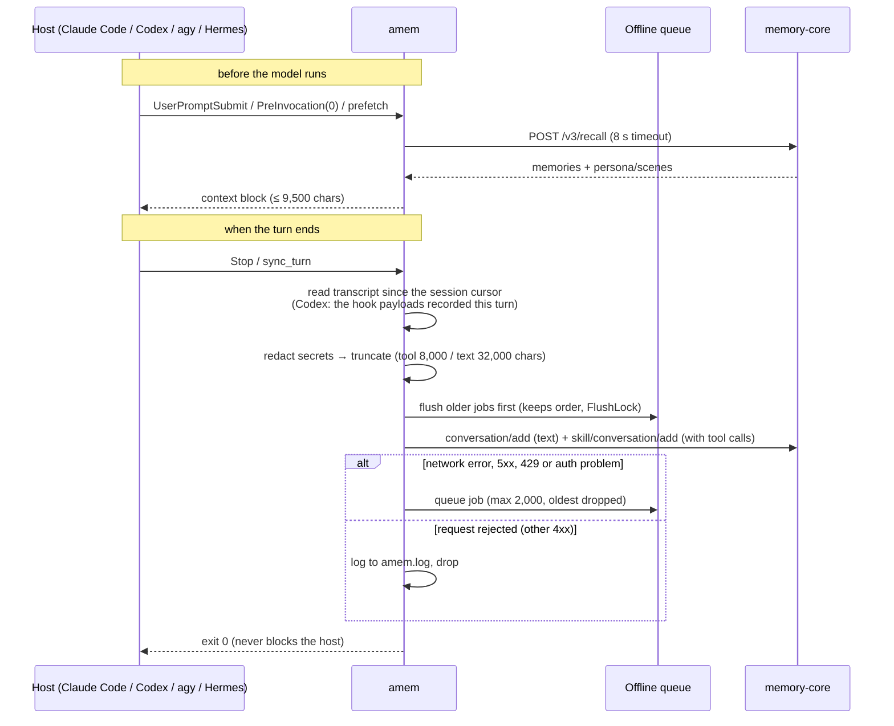

| 部分 | 行為 | 程式碼 |
| --- | --- | --- |
| 設定 | `~/.config/agent-memory/client.json`（0600），由 `amem login` 寫入；可用 `AMEM_*` 環境變數覆寫 | `config.rs` |
| Transcript | 把 Claude Code JSONL、Antigravity steps、Codex hook payload、OpenAI 格式的訊息轉成同一種模型：user/assistant 文字加上 tool_call/tool_result，並移除 `<system-reminder>` 區塊 | `transcript.rs` |
| 游標 | 每個 host 和 session 各一份，存在 `~/.local/share/agent-memory/state`，每次 Stop 只送新的內容 | `hooks.rs` |
| 遮蔽 | 比對 API key、token、私鑰、`password=` 這類字串、以自然語言提到的密碼（英文與亞洲主要語言），以及長得像密碼的字串，替換成 `[REDACTED:<種類>]`。遮蔽在截斷之前執行，避免截斷後留下半個秘密。memory-core 在每條寫入路徑上執行同一個 crate | `memory-redact`（`crates/memory-client/redact`，MIT） |
| 佇列 | 每個請求一個 JSON 檔，放在 `…/agent-memory/queue`，從最舊的開始重送；`.flush.lock`（超過 120 秒視為失效）避免重複送出 | `queue.rs` |
| MCP | stdio server，提供 `memory_recall` 工具，讓 agent 能主動搜尋記憶；`include_sources` 會附上每筆記憶的原始對話 | `mcp.rs` |

各 host 的對接方式：

| Host | 召回 hook | 寫入 hook | 安裝單位 |
| --- | --- | --- | --- |
| Claude Code | `SessionStart`, `UserPromptSubmit` | `Stop` | plugin（`.claude-plugin`、`hooks/hooks.json`、`.mcp.json`）；設定值以 `CLAUDE_PLUGIN_OPTION_*` 傳入 |
| Codex CLI | `UserPromptSubmit` | `Stop`；回合內容由 `UserPromptSubmit` 和 `PostToolUse` 的 payload 組成（transcript 不是穩定介面） | 從 `.agents/plugins/marketplace.json` 安裝的 plugin（`.codex-plugin/plugin.json`、`hooks/hooks.json`、`.mcp.json`）；hook 需先用 `/hooks` 信任 |
| Antigravity | `PreInvocation` 且 `invocationNum == 0` 時，以 `injectSteps` 注入 ephemeral message | `Stop` | plugin（`plugin.json`、`hooks.json`、`mcp_config.json`），裝在使用者層級或 workspace 的 `.agents/plugins` |
| Hermes | `prefetch` | `sync_turn`，由單一背景 worker 依序送出 | `$HERMES_HOME/plugins` 下的 MemoryProvider `agentmemory` |

## 7. Monitor Panel

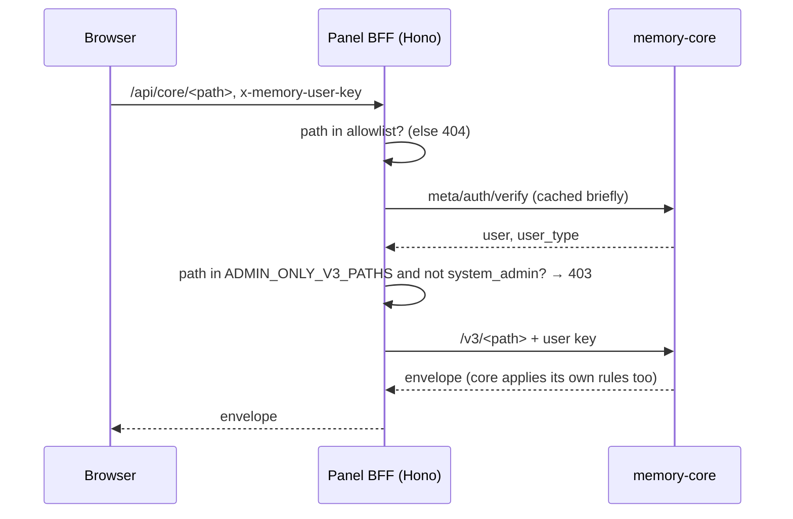

- **Panel 不持有伺服器 API key。** 它轉送登入使用者的 key，由 Core 依該使用者的角色判斷。瀏覽器只持有使用者自己的 key。
- **Allowlist**（`panel/server/src/http/allowlist.ts`）讓 BFF 不會變成任意轉送的 proxy：`internal/*` 和 `department/destroy` 永遠無法經由 Panel 呼叫。
- **v1 權限模型**：只有系統管理者能建立、修改使用者、team、成員和 agent。其他人只能檢視：L0–L3 分頁仍會顯示資料，但編輯和刪除的操作會被隱藏。
- `panel/web` 使用 React + Vite，提供健康狀態、各層筆數、管線狀態、記憶瀏覽（L0–L3）、skills，以及 metadata（使用者、team、成員、agent）。

## 8. 後端與部署拓撲

| Port 類別 | `sqlite` | `postgres` |
| --- | --- | --- |
| L0–L3、metadata、skills、prompts、logs | 每個部門一個檔案；FTS5 + sqlite-vec `vec0`（不可用時改為暴力搜尋） | 每個部門一個 schema；tsvector + pgvector HNSW |

| Port 類別 | `local` | `redis` |
| --- | --- | --- |
| 管線狀態 | `system.db` | JSON + due ZSET |
| Job 佇列 | 行程內 channel | ready list、delayed/processing ZSET、lease（至少送達一次） |
| `KeyLock` | 分段的 async mutex | `SET NX PX` + 續約 |

不論選哪種儲存後端，檔案（skill 資源、原始 session 回合）一律放在 `<data>/departments/<id>/`。

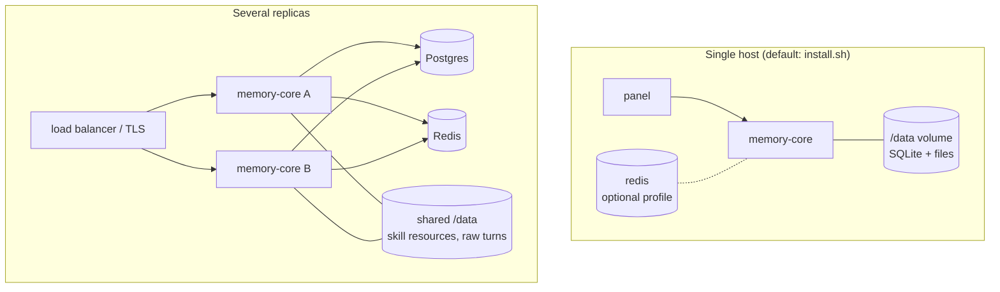

- Docker Compose 的服務：`memory-core`、`memory-panel`，以及同名 profile 下的 `redis`、`postgres`。
- Volume：
  - `memory-core-data`、`redis-data`、`postgres-data`
  - `claude-config`、`antigravity-config`、`codex-config`：CLI 的登入資料
  - `PROJECT_DIR` 以 bind mount 掛在 `/workspace`，給 CLI 型的 LLM 使用
- 映像標記為 `memory-core:${MEMORY_IMAGE_TAG}` 和 `memory-panel:${MEMORY_IMAGE_TAG}`，預設是 `local`。同一台主機上的每套部署要用不同的 tag，否則 build 其中一套會覆蓋另一套的映像。
- 多節點需要 `storage.backend = postgres`、`coordination.backend = redis`，以及共享的 `<data>` volume。既有的 SQLite 安裝可以用 `migrate-to-postgres.sh` 搬過去（[MIGRATE-TO-POSTGRES.zh-tw.md](MIGRATE-TO-POSTGRES.zh-tw.md)）。
- Client 透過網路連線時，請在 8420 埠前面加上 TLS，見 REMOTE-CLIENTS.zh-tw.md §2。

## 9. 升級與移除

0.1.1 之前，沒有指定 team 或 agent 的寫入會進到 `default` 桶，而 0.1.1 的資料平面已不再提供這些資料。維運人員只要用 `upgrade.sh` 搬移一次。它背後只呼叫一個只需 Bearer key 的 endpoint：

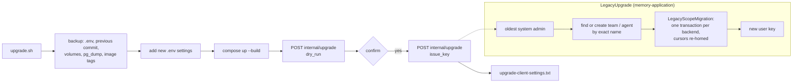

- 升級可以安全地重複執行：舊桶已空時不會有任何動作；目標 agent 若已有 L2/L3，會以 409 拒絕，而不是合併。
- `uninstall.sh client` 與 `uninstall.sh server` 用來反向移除安裝；除非加上 `--purge-data`，否則資料 volume 會保留。

## 10. 設計細節

- **儲存配置**：
  - `<data>/system.db` 保存所有部門的持久化管線計時器。
  - 使用 SQLite 時，`<data>/departments/<id>/memory.db` 保存單一部門的 L0–L3、metadata、skills 和 logs。
  - `<data>/departments/<id>/{sessions,skills}/` 保存原始 session 回合和 skill 資源檔。
- **只追加的 profile**：L2 場景和 L3 persona 的每次變更都是一個新版本；除了清除 chat memory，沒有任何操作會改寫或刪除版本。場景在各版本間保有固定的 id，合併會把併入的版本記為來源，消失的場景會多一個最終的 `retire` 版本。關鍵欄位是資料表欄位，內文維持 markdown，其他屬性放在 `attrs`；client 看到的 markdown 檔（帶 META 標頭的 `scene_blocks/*.md`、附上場景導覽的 `persona.md`）都是從這些資料產生的。
- **延遲綁定**：兩組建構循環（memory ↔ pipeline、meta ↔ chat-memory）用 `OnceLock` 註冊協作者來打破，避免相依圖變成雙向。
- **協調用的 port**：
  - `KeyLock`（`ports/coordination.rs`）保護管線狀態的讀取、修改、寫回。
  - Worker 另外用一個獨立的 `KeyLock` 確保同一個 job 不會同時執行；共用的話，本機的分段鎖可能讓 job 等到自己。
  - `QueueBackend` 提供 pop / ack / extend / push_later / dead_letter，送達語意由後端決定。
- **刪除部門**時，會依序組合各後端的清理步驟（`CompositeLifecycle`）：儲存（刪檔或刪 schema）、檔案、狀態。
- **不做廠商整合**：刻意不提供 analytics、外部任務來源和上游模型群組路由。
