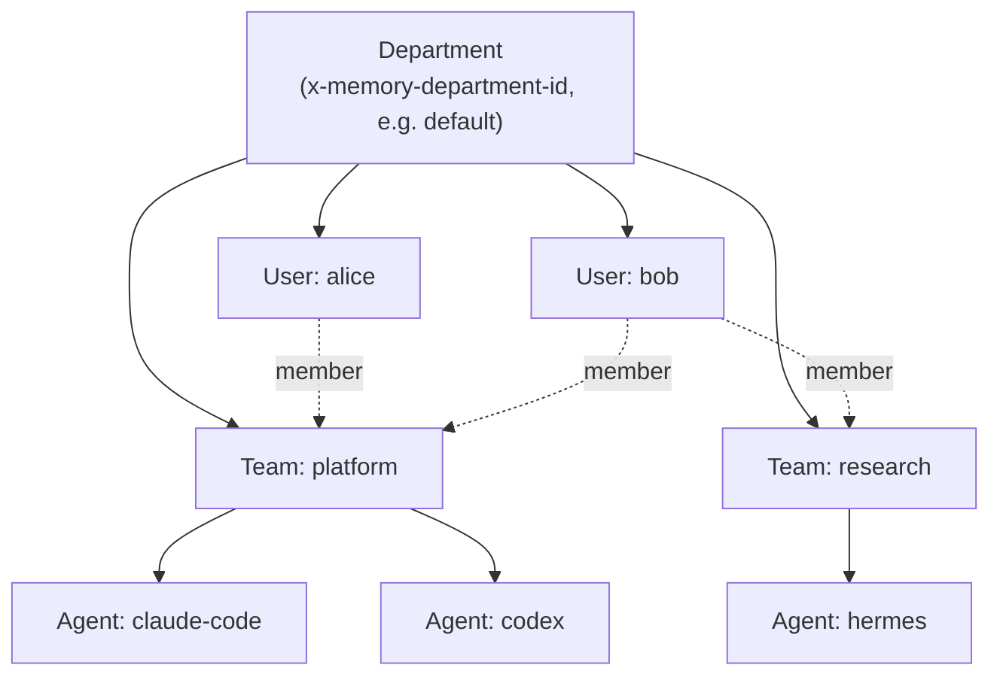
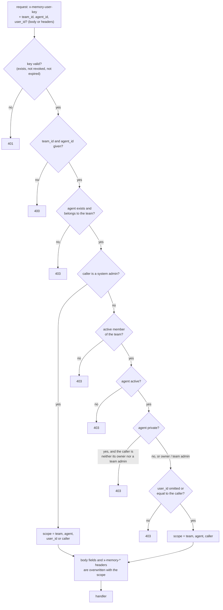
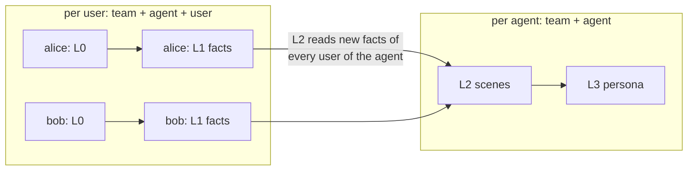

# Departments, teams, users and agents

[繁體中文](COLLABORATION.zh-tw.md)

One Agent Memory server can hold memory for many people, many teams and many AI tools at once. This guide starts with the concepts, which are useful to anyone. It then covers how an administrator sets things up, and ends with how isolation works in the code.

## Contents

**Part 1. Concepts**
1. [The four levels](#1-the-four-levels)
2. [What is private and what is shared](#2-what-is-private-and-what-is-shared)
3. [Choosing a layout](#3-choosing-a-layout)

**Part 2. Setting it up**

4. [Roles](#4-roles)
5. [Create users, teams and agents](#5-create-users-teams-and-agents)
6. [Point each client at a team and an agent](#6-point-each-client-at-a-team-and-an-agent)
7. [Day-to-day administration](#7-day-to-day-administration)

**Part 3. How it works**

8. [The scope model](#8-the-scope-model)
9. [Authorization of memory requests](#9-authorization-of-memory-requests)
10. [Pipeline and recall per scope](#10-pipeline-and-recall-per-scope)
11. [Metadata-plane rules](#11-metadata-plane-rules)
12. [Operational state by role](#12-operational-state-by-role)
13. [Departments and storage](#13-departments-and-storage)
14. [Limits and current gaps](#14-limits-and-current-gaps)

---

# Part 1. Concepts

## 1. The four levels



| Level | What it is | Example |
| --- | --- | --- |
| **Department** | A completely separate memory space with its own users, teams and data. Clients select it with `x-memory-department-id`. | `default`; or `engineering` and `sales` |
| **User** | A person, with one or more keys (`sk-mem-…`). Users belong to a department and can join any number of its teams. | alice, bob |
| **Team** | A group of users that work together. Every memory belongs to a team. | platform, research |
| **Agent** | One AI assistant identity inside a team, usually one per tool or per purpose. An agent belongs to exactly one team. | `claude-code`, `codex`, `hermes` |

Every request to the memory API names a team and an agent. The user comes from the key.

## 2. What is private and what is shared

Memory is stored in layers (see [ARCHITECTURE.md §4](ARCHITECTURE.md#4-memory-model-and-pipeline)). They are not all scoped the same way:

| Layer | Scoped by | Who can read it |
| --- | --- | --- |
| L0 conversations | team + agent + **user** | Only that user (and system admins) |
| L1 facts (atoms) | team + agent + **user** | Only that user (and system admins); recall returns only your own facts |
| L2 scenes | team + agent | Every member of the team who uses that agent |
| L3 persona | team + agent | Every member of the team who uses that agent |
| Skills | team (owned by an agent) | Every member of the team; only the owning agent changes them |

The important consequence: **scenes and the persona of an agent are built from the facts of everyone who uses that agent.** If alice and bob both talk to the same agent, its scenes and persona describe both of them, and each of them sees the result in recall. Their raw conversations and individual facts stay private.

Nothing is shared **between agents**, not even inside one team: every agent has its own scenes and persona, and recall only looks at the agent you name.

## 3. Choosing a layout

**A. One person, several tools.** One user and one team. Give each tool its own agent (`claude-code`, `codex`, `hermes`) when you want separate personas, or let them all use one agent when you want a single shared memory.

**B. A team that shares knowledge.** Every member uses the same agent, for example `team-assistant`. Scenes and the persona collect what the team works on together. Use this only when people are comfortable with their facts shaping a shared profile.

**C. A team, private profiles.** Everyone is in the same team for administration, but each person gets their own agent (`alice-claude`, `bob-claude`), created with `"visibility": "private"`. Nothing is distilled across people: only the agent's owner and the team's admins can use a private agent, so no other member can read its scenes, persona or skills, write to them, or feed it their conversations. Skills of team agents (the default `"visibility": "team"`) are visible to the whole team; skills of a private agent are not.

An agent created before this rule keeps the visibility it was created with, `team` by default. To make an existing per-person agent private, its owner or a system admin updates it:

```bash
curl -X POST "$CORE/v3/meta/agent/update" \
  -H "Authorization: Bearer $AGENT_MEMORY_API_KEY" \
  -H "x-memory-department-id: default" \
  -H "x-memory-user-key: $USER_KEY" \
  -H "content-type: application/json" \
  -d '{"agent_id": "agt-…", "visibility": "private"}'
```

**D. Several teams.** Each group or project gets a team. A person in two teams configures a client per team (see §6). Data never crosses teams.

**E. Separate departments.** Groups that must not share anything use separate departments. Departments share nothing, not users, not keys and not data, and each has its own administrator. This is the largest unit one server holds.

---

# Part 2. Setting it up

## 4. Roles

| Role | Where | What it allows |
| --- | --- | --- |
| **System admin** | Department | Everything: users, keys, teams, members and agents, in any team. Can read and write the memory of any user. Created by `install.sh` (`init-admin`). |
| **Normal user** | Department | Uses memory in the teams they belong to; manages their own keys. |
| Team **admin** | Team | Manages the team's members and agents; full rights on the team's non-private assets. A team's owner is made its admin when the team is created. |
| Team **leader** | Team | Everything a member can do, and sees how the whole team's distillation is doing: pipeline state, generation logs and dead letters of every member (§12). Cannot open other members' conversations or facts, and cannot manage members. |
| Team **member** | Team | Uses memory; can create agents they own; reads the team's non-private assets. Sees the operational state of the team's shared layers and of their own work. |

**The Panel** keeps it simple: only system admins can change anything there (users, keys, teams, members, agents, memory). Everyone else can sign in and view, and the dashboard and generation logs show them what §12 allows. Team admins can still use their rights through the API.

## 5. Create users, teams and agents

### In the Panel

Sign in as a system admin and open **Metadata**:

1. **Users → Create**: enter a username. The user's first key is shown once; give it to them safely.
2. **Teams → Create**: name the team and pick its owner.
3. Open the team and **add members**, choosing a role for each.
4. In the same team, **create agents**, for example one per tool.

Every client needs four values: the server URL, the user's key, the team id and the agent id. The ids are shown in the Panel.

### With the API

The same steps with `curl`. Metadata calls need the user key of a system admin of the department; the server API key is not needed (and does not replace the user key):

```bash
CORE=https://memory.example.com
H=(-H "x-memory-department-id: default"
   -H "x-memory-user-key: $ADMIN_KEY" -H "content-type: application/json")

# a user (the response includes user_id and default_user_key, shown once)
curl -sS -X POST $CORE/v3/meta/user/create "${H[@]}" -d '{"username":"alice"}'
# a team owned by alice (the owner becomes its admin)
curl -sS -X POST $CORE/v3/meta/team/create "${H[@]}" -d '{"name":"platform","owner_user_id":"usr-…"}'
# add bob as a member
curl -sS -X POST $CORE/v3/meta/team-member/add "${H[@]}" -d '{"team_id":"team-…","user_id":"usr-…","role":"member"}'
# an agent in the team
curl -sS -X POST $CORE/v3/meta/agent/create "${H[@]}" -d '{"team_id":"team-…","owner_user_id":"usr-…","name":"codex"}'
# an extra key for a user (e.g. one per laptop)
curl -sS -X POST $CORE/v3/meta/user-key/create "${H[@]}" -d '{"user_id":"usr-…","name":"laptop"}'
```

All endpoints are listed in [API.md](API.md#metadata-plane-x-memory-user-key-required).

## 6. Point each client at a team and an agent

`amem login` stores one default team and agent per machine:

```bash
amem login --server-url https://memory.example.com --team-id team-… --agent-id agt-… --user-key -
```

To use **a different agent per tool**, override the agent for that tool only:

| Tool | How to override |
| --- | --- |
| Claude Code | The plugin's settings (`/plugin configure agent-memory@agent-memory`): fill in **agent ID** (and team ID if it differs) |
| Codex CLI | Start Codex with `AMEM_AGENT_ID=agt-…` in its environment |
| Antigravity | In the plugin's `hooks.json`, prefix each command with `AMEM_AGENT_ID=agt-… `; in `mcp_config.json`, add it under `env` |
| Hermes | Set `AMEM_AGENT_ID=agt-…` in Hermes's environment |

To work in **two teams** from one machine, keep one settings file per team and select it with `AMEM_CONFIG=/path/to/team.json`. Alternatively set `AMEM_TEAM_ID` and `AMEM_AGENT_ID` together. `amem status` shows which team and agent are in effect.

## 7. Day-to-day administration

| Task | How | Effect |
| --- | --- | --- |
| Someone leaves a team | Remove the member (Panel, or `team-member/remove`) | Their next memory request to that team gets `403`. Their past memories stay. |
| A key leaks or a laptop is lost | Revoke that key (Panel, or `user-key/revoke`) | Requests with it get `401`; the user's other keys keep working. |
| Give someone a fresh start | Create a new agent for them | The old agent's scenes and persona are left behind. |
| Check who is in a team | Panel **Teams**, or `team-member/list` | — |

Default limits per department (`config/memory-core.example.yaml`, section `metadata`): 500 users, 100 teams, 20 active keys per user.

---

# Part 3. How it works

## 8. The scope model

Two scope types decide where data lives (`memory-domain/src/scope.rs`, `profile.rs`):

| Type | Fields | Used for |
| --- | --- | --- |
| `MemoryScope` | team_id, agent_id, user_id (+ optional task_id) | L0 conversations, L1 atoms, raw session turns, per-session pipeline state |
| `ProfileScope` | team_id, agent_id | L2 scene files, the L3 persona, per-profile pipeline state |

Stores filter on these fields in every query. For example, the SQLite store adds `team_id = ? AND agent_id = ? AND user_id = ?` for a `MemoryScope`, and `team_id = ? AND agent_id = ?` for a `ProfileScope`. The Postgres store does the same. All of this happens inside one department, which is itself a separate database file or schema (§13).

## 9. Authorization of memory requests

One middleware (`memory-gateway/src/authz.rs`) runs before every memory and skill handler. The decision itself is a pure function, `authorize_memory_scope` (`memory-domain/src/meta/memory_access.rs`):



Properties to rely on when extending the API:

- **Fail closed.** A route counts as a read only if its last path segment is a known read suffix (`query`, `search`, `count`, `read`, `recall`, `list`, …). Anything else is a write.
- **Handlers only see an authorized scope.** The middleware rewrites the request, so a new handler is isolated without extra code.
- **Private and archived agents.** An archived agent is refused (system admins excepted). A private agent is usable by its owner, the team's admins and system admins only; its skills follow the same rule, since skill calls go through this middleware too.
- **Roles are flat in the memory API.** `role_allows` grants every role access to the caller's own memory only. Reaching another user's memory is reserved for system admins. Finer per-role rules would go into that one function.

## 10. Pipeline and recall per scope



- **L1** runs per user session (`MemoryScope`): it reads that user's new conversation rows and writes that user's facts.
- **L2** runs per profile (`ProfileScope`). It reads new facts with `after_seq(profile, …)`, which means the facts of **every user** of that team and agent, and merges them into the agent's scenes. **L3** rebuilds the persona from those scenes.
- **Recall** combines both scopes. It searches the **caller's** L1 facts (`AtomSelector::Scope`) and appends the **agent's** persona and scene navigation (`ProfileScope`). This is the mechanism behind the sharing rule in §2. Asked for the source conversation of its facts (`include_sources`), it reads only the **caller's** own L0 messages: another member's raw conversation never appears, even when a shared scene or persona was built from it.
- **Skills** are stored per team with an owner agent and owner user. Members of the team can read and search them (`team_scope` searches the whole team; the default listing shows the calling agent's skills). Only the owner agent can change one (`SKILL_NOT_OWNER`). What skill extraction proposes for an agent waits until the conversation's user (on an agent they may use), an admin of the team, or a system admin approves it (Panel → Skills).

## 11. Metadata-plane rules

Metadata calls (`/v3/meta/*`) identify the caller by user key. They are checked by the meta services, and assets additionally by a pure policy (`memory-domain/src/meta/access.rs`):

1. The asset must not be archived.
2. The owner may do anything.
3. Otherwise the caller must be an active member of the asset's team.
4. Visibility:
   - `private`: owner only, team admins included.
   - `restricted`: team admins, or users granted by an ACL entry.
   - `task`: read-only for non-admins.
   - `team` and `agent`: fall through to role defaults.
5. Role defaults: an admin has read, write, assign and share; a leader or member has read.
6. Otherwise, ACL entries that **allow** the action to the user, the role or the agent.

ACL `deny` entries are stored but not consulted yet.

## 12. Operational state by role

Pipeline state (`/v3/pipeline/status`), generation logs (`/v3/memory-generation-log/*`) and dead letters (`/v3/pipeline/dead-letter/list`) say how distillation is doing for each scope. They name teams, agents, users and sessions, never memory content. Who sees which rows is one rule, `ScopeVisibility` (`memory-domain/src/meta/visibility.rs`):

| Caller | Sees |
| --- | --- |
| A system admin | The whole department |
| The operator: the server API key on `/v3/internal/…` (`memory-server generations`, `dead-letters`) | The whole department |
| A team **admin** or **leader** | Everything of that team: every member's L0/L1 work and the agents' L2/L3 work |
| A team **member** | The team's shared L2/L3 work, and their own L0/L1 work |
| Anyone | Nothing of teams they are not an active member of |

- Skill-extraction dead letters name only a task, so only the whole-department view lists them.
- Redriving dead letters spends the department's LLM budget: only a system admin (or the operator) may do it.
- These routes need a user key of the department. The server API key alone gets 401 on them; it opens only the `/v3/internal/…` views.
- The worker's last error can come from any team, so only the whole-department view gets it. `/health`, which needs no key, never shows it.
- Seeing a row is not reading memory. Each scope row carries `can_read_memory`, the data-plane rule of §9: your own scopes and your teams' shared layers. The Panel links a row to the memory browser only when it is true. A leader sees that a member's session was distilled, but cannot open it.
- Every row has a unique `key`, plus `team_name`, `agent_name` and `username`. A name is absent when its id no longer exists.

## 13. Departments and storage

- A department is created by `init-admin` (below). Every other request for a department that does not exist is refused without storing anything: data-plane and department routes answer as for a wrong user key, `meta/auth/verify` with `valid: false`, operator routes (server API key) with 404 `unknown_department`. The answer does not tell whether a department exists, but the response time can (department names are not secrets; [ARCHITECTURE](ARCHITECTURE.md#three-trust-zones)). With SQLite that is a database file at `<data>/departments/<id>/memory.db`; with Postgres, a schema of its own. Files (skill resources, raw session turns) live under `<data>/departments/<id>/`.
- Users are per department, so each new department needs its own administrator: `POST /v3/internal/meta/user/init-admin` with that department's `x-memory-department-id`.
- One Panel deployment serves one department (`CORE_DEPARTMENT_ID`). Run a second Panel to manage another one.
- `POST /v3/department/destroy` removes a department and everything in it, including its dead letters. It needs the server API key; the department is named in the body, no header needed. Jobs still queued for it are dropped when a worker takes them; if the same department id is initialized again before that, such a job runs against the new department.

## 14. Limits and current gaps

- **Roles are flat in the memory API**, and team admins have no Panel UI yet (see §4 and §9).
- **The agent status is not checked** by the memory API. An agent marked inactive still accepts requests; remove members or revoke keys to cut access.
- **Shared agents share their profile.** Scenes and the persona mix the facts of everyone who uses an agent (§2). Give people their own agents if that is not wanted.
- **One team and agent per client configuration.** Use per-tool overrides or separate settings files (§6).
- **ACL deny entries are not applied** yet (§11).
