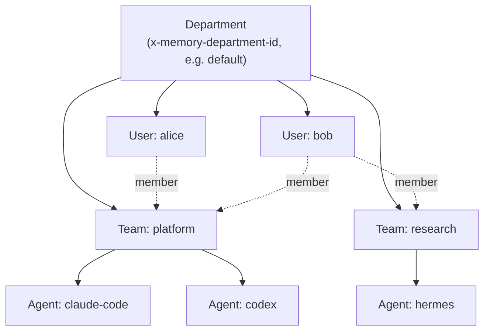
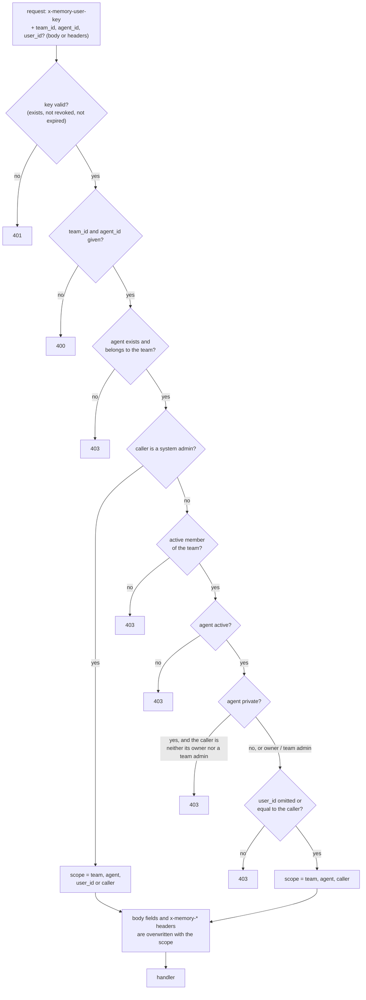
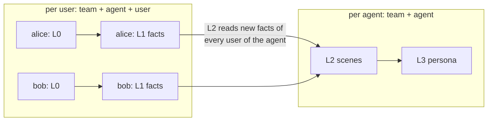

# 部門、團隊、使用者與 Agent

[English](COLLABORATION.md)

一台 Agent Memory 伺服器可以同時保存許多人、許多 team、許多 AI 工具的記憶。這份文件先說明概念，任何人都適用；接著說明管理者如何設定；最後說明隔離在程式碼裡是怎麼做到的。

## 目錄

**第一部分：概念**
1. [四個層級](#1-四個層級)
2. [哪些是私有的、哪些是共用的](#2-哪些是私有的哪些是共用的)
3. [選擇配置方式](#3-選擇配置方式)

**第二部分：設定**

4. [角色](#4-角色)
5. [建立使用者、team 與 agent](#5-建立使用者team-與-agent)
6. [讓每個 client 指向 team 與 agent](#6-讓每個-client-指向-team-與-agent)
7. [日常管理](#7-日常管理)

**第三部分：運作原理**

8. [範圍模型](#8-範圍模型)
9. [記憶請求的授權](#9-記憶請求的授權)
10. [依範圍運作的管線與召回](#10-依範圍運作的管線與召回)
11. [Metadata 平面的規則](#11-metadata-平面的規則)
12. [依角色檢視運作狀態](#12-依角色檢視運作狀態)
13. [部門與儲存](#13-部門與儲存)
14. [限制與目前的不足](#14-限制與目前的不足)

圖中的識別名稱保留英文，方便對照程式碼。

---

# 第一部分：概念

## 1. 四個層級



| 層級 | 說明 | 範例 |
| --- | --- | --- |
| **部門（department）** | 完全獨立的記憶空間，有自己的使用者、team 和資料。Client 用 `x-memory-department-id` 選擇。 | `default`；或 `engineering`、`sales` |
| **使用者** | 一個人，擁有一把或多把 key（`sk-mem-…`）。使用者屬於某個部門，可以加入其中任意多個 team。 | alice、bob |
| **Team** | 一起工作的一群人。每一筆記憶都屬於某個 team。 | platform、research |
| **Agent** | team 裡的一個 AI 助理身分，通常每個工具或每種用途一個。一個 agent 只屬於一個 team。 | `claude-code`、`codex`、`hermes` |

每個記憶 API 請求都要指定 team 和 agent，使用者則由 key 決定。

## 2. 哪些是私有的、哪些是共用的

記憶分成好幾層（見 [ARCHITECTURE.zh-tw.md §4](ARCHITECTURE.zh-tw.md#4-記憶模型與蒸餾管線)），各層的範圍不一樣：

| 層 | 範圍 | 誰讀得到 |
| --- | --- | --- |
| L0 對話 | team + agent + **使用者** | 只有該使用者（以及系統管理者） |
| L1 事實（atom） | team + agent + **使用者** | 只有該使用者（以及系統管理者）；召回只會回傳你自己的事實 |
| L2 場景 | team + agent | 使用這個 agent 的所有 team 成員 |
| L3 persona | team + agent | 使用這個 agent 的所有 team 成員 |
| Skills | team（由某個 agent 擁有） | team 的所有成員；只有擁有它的 agent 能修改 |

最重要的影響是：**一個 agent 的場景和 persona，是用所有使用這個 agent 的人的事實蒸餾出來的。** 如果 alice 和 bob 都跟同一個 agent 對話，它的場景和 persona 會同時描述他們兩人，而兩人在召回時都會看到這個結果。不過他們的原始對話和個人事實仍然是私有的。場景會記錄自己由哪些事實寫成，但 `scenario/atoms`（以及 Panel 的 L2 頁）只讓每個人看到自己的部分：alice 看得到場景背後她自己的事實，其他人的只看到數量，看不到 bob 的事實。

**不同 agent 之間不共用任何東西**，即使在同一個 team 裡也一樣：每個 agent 有自己的場景和 persona，召回也只看你指定的那個 agent。

## 3. 選擇配置方式

**A. 一個人、多個工具**：一位使用者、一個 team。想要各自獨立的 persona，就讓每個工具用自己的 agent（`claude-code`、`codex`、`hermes`）；想要共用同一份記憶，就讓它們都用同一個 agent。

**B. 共享知識的團隊**：所有成員使用同一個 agent，例如 `team-assistant`，場景和 persona 會累積團隊共同的工作內容。只有在大家都能接受自己的事實影響共用輪廓時才這樣做。

**C. 同一個團隊、各自的輪廓**：大家為了方便管理放在同一個 team，但每個人用自己的 agent（`alice-claude`、`bob-claude`），建立時設定 `"visibility": "private"`。不會跨人蒸餾：私人 agent 只有 owner 和 team 的管理者能使用，其他成員讀不到它的場景、persona 和 skills，也不能寫入或把自己的對話餵給它。team agent（預設的 `"visibility": "team"`）的 skills 整個 team 都看得到；私人 agent 的 skills 則不會分享給 team。

在這條規則之前建立的 agent，會維持建立時的可見性，預設是 `team`。要把既有的個人 agent 改成私人的，由它的 owner 或系統管理者更新：

```bash
curl -X POST "$CORE/v3/meta/agent/update" \
  -H "Authorization: Bearer $AGENT_MEMORY_API_KEY" \
  -H "x-memory-department-id: default" \
  -H "x-memory-user-key: $USER_KEY" \
  -H "content-type: application/json" \
  -d '{"agent_id": "agt-…", "visibility": "private"}'
```

**D. 多個團隊**：每個小組或專案各自一個 team。同時在兩個 team 的人，每個 team 各設定一份 client（見第 6 節）。資料不會跨 team。

**E. 不同部門**：彼此不能共用任何東西的單位，使用不同的部門。部門之間什麼都不共用：使用者、key、資料都各自獨立，也各有自己的管理者。一台伺服器能容納的最大單位就是部門。

---

# 第二部分：設定

## 4. 角色

| 角色 | 層級 | 權限 |
| --- | --- | --- |
| **系統管理者** | 部門 | 全部權限：任何 team 的使用者、key、team、成員和 agent。可以讀寫任何使用者的記憶。由 `install.sh` 建立（`init-admin`）。 |
| **一般使用者** | 部門 | 在所屬的 team 中使用記憶，管理自己的 key。 |
| Team **admin** | Team | 管理 team 的成員和 agent；對 team 中非私有的 asset 有完整權限。建立 team 時，team 的 owner 會成為它的 admin。 |
| Team **leader** | Team | 擁有 member 的所有權限，另外可以看到整個 team 的蒸餾運作狀態：每位成員的管線狀態、生成紀錄和 dead letter（第 12 節）。不能開啟其他成員的對話或事實，也不能管理成員。 |
| Team **member** | Team | 使用記憶；可以建立自己擁有的 agent；可以讀取 team 中非私有的 asset。可以看到 team 共用層和自己工作的運作狀態。 |

**Panel** 刻意保持簡單：只有系統管理者能在 Panel 上修改任何東西（使用者、key、team、成員、agent、記憶），其他人登入後只能檢視，dashboard 和生成紀錄只會顯示第 12 節允許的內容。Team admin 仍然可以透過 API 行使自己的權限。

## 5. 建立使用者、team 與 agent

### 在 Panel 操作

以系統管理者登入，打開 **Metadata**：

1. **Users → Create**：輸入使用者名稱。使用者的第一把 key 只會顯示一次，請用安全的方式交給對方。
2. **Teams → Create**：輸入 team 名稱並選擇 owner。
3. 打開該 team，**加入成員**，並為每位成員選擇角色。
4. 在同一個 team 裡**建立 agent**，例如每個工具一個。

每個 client 需要四個值：伺服器 URL、使用者的 key、team id、agent id。id 都可以在 Panel 上看到。

### 使用 API

以下是用 `curl` 完成相同步驟。Metadata 呼叫需要該部門系統管理者的 user key；不需要伺服器 API key（它也不能代替 user key）：

```bash
CORE=https://memory.example.com
H=(-H "x-memory-department-id: default"
   -H "x-memory-user-key: $ADMIN_KEY" -H "content-type: application/json")

# 建立使用者（回應包含 user_id 和 default_user_key，key 只顯示一次）
curl -sS -X POST $CORE/v3/meta/user/create "${H[@]}" -d '{"username":"alice"}'
# 建立由 alice 擁有的 team（owner 會成為 admin）
curl -sS -X POST $CORE/v3/meta/team/create "${H[@]}" -d '{"name":"platform","owner_user_id":"usr-…"}'
# 把 bob 加為成員
curl -sS -X POST $CORE/v3/meta/team-member/add "${H[@]}" -d '{"team_id":"team-…","user_id":"usr-…","role":"member"}'
# 在 team 裡建立 agent
curl -sS -X POST $CORE/v3/meta/agent/create "${H[@]}" -d '{"team_id":"team-…","owner_user_id":"usr-…","name":"codex"}'
# 替使用者再發一把 key（例如每台筆電一把）
curl -sS -X POST $CORE/v3/meta/user-key/create "${H[@]}" -d '{"user_id":"usr-…","name":"laptop"}'
```

所有 endpoint 列在 [API.zh-tw.md](API.zh-tw.md#metadata-平面需要-x-memory-user-key)。

## 6. 讓每個 client 指向 team 與 agent

`amem login` 會在每台機器上保存一組預設的 team 和 agent：

```bash
amem login --server-url https://memory.example.com --team-id team-… --agent-id agt-… --user-key -
```

若要**讓每個工具使用不同的 agent**，只針對該工具覆寫 agent：

| 工具 | 覆寫方式 |
| --- | --- |
| Claude Code | 在 plugin 設定（`/plugin configure agent-memory@agent-memory`）填入 **agent ID**（team 不同時也填 team ID） |
| Codex CLI | 啟動 Codex 時，在環境變數設定 `AMEM_AGENT_ID=agt-…` |
| Antigravity | 在 plugin 的 `hooks.json` 裡，於每個指令前加上 `AMEM_AGENT_ID=agt-… `；在 `mcp_config.json` 裡加到 `env` |
| Hermes | 在 Hermes 的環境變數設定 `AMEM_AGENT_ID=agt-…` |

若要在同一台機器上**使用兩個 team**，每個 team 各存一份設定檔，用 `AMEM_CONFIG=/path/to/team.json` 選擇；也可以同時設定 `AMEM_TEAM_ID` 和 `AMEM_AGENT_ID`。`amem status` 會顯示目前實際生效的 team 和 agent。

## 7. 日常管理

| 工作 | 做法 | 結果 |
| --- | --- | --- |
| 有人離開 team | 移除該成員（Panel，或 `team-member/remove`） | 他之後對該 team 的記憶請求會收到 `403`；過去的記憶仍會保留 |
| key 外洩或筆電遺失 | 撤銷那把 key（Panel，或 `user-key/revoke`） | 用它的請求會收到 `401`；該使用者的其他 key 不受影響 |
| 讓某人重新開始 | 替他建立新的 agent | 舊 agent 的場景和 persona 會留在原處 |
| 查看 team 成員 | Panel 的 **Teams**，或 `team-member/list` | — |

每個部門的預設上限（`config/memory-core.example.yaml` 的 `metadata` 區段）：500 位使用者、100 個 team、每位使用者 20 把有效 key。

---

# 第三部分：運作原理

## 8. 範圍模型

資料存放在哪裡，由兩種範圍型別決定（`memory-domain/src/scope.rs`、`profile.rs`）：

| 型別 | 欄位 | 用途 |
| --- | --- | --- |
| `MemoryScope` | team_id、agent_id、user_id（可加 task_id） | L0 對話、L1 atom、原始 session 回合、以 session 為單位的管線狀態 |
| `ProfileScope` | team_id、agent_id | L2 場景檔、L3 persona、以 profile 為單位的管線狀態 |

每次查詢，儲存層都會用這些欄位過濾。例如 SQLite 對 `MemoryScope` 會加上 `team_id = ? AND agent_id = ? AND user_id = ?`，對 `ProfileScope` 則加上 `team_id = ? AND agent_id = ?`；Postgres 也一樣。這一切都發生在單一部門內，而部門本身就是獨立的資料庫檔或 schema（第 13 節）。

## 9. 記憶請求的授權

每個記憶和 skill 的 handler 之前，都會先經過同一個 middleware（`memory-gateway/src/authz.rs`）。判斷本身是一個純函式 `authorize_memory_scope`（`memory-domain/src/meta/memory_access.rs`）：



擴充 API 時可以依賴的特性：

- **預設拒絕**：只有路徑最後一段是已知的讀取字尾（`query`、`search`、`count`、`read`、`recall`、`list` 等），才算讀取，其餘一律視為寫入。
- **Handler 只會看到已授權的範圍**：middleware 會改寫請求，新的 handler 不需要額外程式碼就有隔離。
- **私人與已封存的 agent**：已封存的 agent 一律拒絕（系統管理者除外）。私人 agent 只有 owner、team 的管理者和系統管理者能使用；它的 skills 也一樣，因為 skill 的呼叫同樣經過這個 middleware。
- **記憶 API 的角色是扁平的**：`role_allows` 讓每種角色都只能存取呼叫者自己的記憶，存取別人的記憶只保留給系統管理者。未來若要依角色細分，只需要改這一個函式。

## 10. 依範圍運作的管線與召回



- **L1** 以使用者的 session 為單位執行（`MemoryScope`）：讀取該使用者新的對話，寫入該使用者的事實。
- **L2** 以 profile 為單位執行（`ProfileScope`）。它用 `after_seq(profile, …)` 讀取新事實，也就是該 team 和 agent 底下**所有使用者**的事實，再合併進這個 agent 的場景。**L3** 再根據這些場景重建 persona。
- **召回**結合兩種範圍。它搜尋**呼叫者自己**的 L1 事實（`AtomSelector::Scope`），再附上**這個 agent** 的 persona 和場景導覽（`ProfileScope`）。第 2 節的共用規則就是由此而來。
- **Skills** 以 team 為單位儲存，並記錄擁有它的 agent 和使用者。team 成員都能讀取和搜尋（`team_scope` 會搜尋整個 team；預設列表只顯示呼叫中的 agent 的 skill）。只有擁有它的 agent 能修改（`SKILL_NOT_OWNER`）。skill 萃取替某個 agent 提出的修改，要等對話的使用者本人（限於他能使用的 agent）、該 team 的 admin，或系統管理員核准後才生效（Panel → Skills）。

## 11. Metadata 平面的規則

Metadata 呼叫（`/v3/meta/*`）以 user key 識別呼叫者，並由各 meta service 檢查權限。asset 另外由一個純函式政策判斷（`memory-domain/src/meta/access.rs`）：

1. asset 不能是已封存狀態。
2. 擁有者可以做任何事。
3. 否則，呼叫者必須是該 asset 所屬 team 的有效成員。
4. 可見度：
   - `private`：只有擁有者，team admin 也不行。
   - `restricted`：team admin，或經 ACL 授權的使用者。
   - `task`：非 admin 只能讀取。
   - `team` 和 `agent`：交由角色預設權限決定。
5. 角色預設權限：admin 有讀、寫、指派、分享；leader 和 member 只能讀。
6. 否則看 ACL 中是否有條目把這個動作 **allow** 給該使用者、角色或 agent。

ACL 的 `deny` 條目會被儲存，但目前不會被套用。

## 12. 依角色檢視運作狀態

管線狀態（`/v3/pipeline/status`）、生成紀錄（`/v3/memory-generation-log/*`）和 dead letter（`/v3/pipeline/dead-letter/list`）呈現每個範圍的蒸餾運作情形。它們會列出 team、agent、使用者和 session，但不含任何記憶內容。誰能看到哪些列，由同一條規則 `ScopeVisibility`（`memory-domain/src/meta/visibility.rs`）決定：

| 呼叫者 | 看得到 |
| --- | --- |
| 系統管理者 | 整個部門 |
| 營運者：在 `/v3/internal/…` 使用伺服器 API key（`memory-server generations`、`dead-letters`） | 整個部門 |
| Team **admin** 或 **leader** | 該 team 的全部：每位成員的 L0/L1 工作，以及 agent 的 L2/L3 工作 |
| Team **member** | team 共用的 L2/L3 工作，以及自己的 L0/L1 工作 |
| 任何人 | 自己不是有效成員的 team，一律看不到 |

- Skill 擷取的 dead letter 只記錄 task，所以只有整個部門的檢視範圍會列出它們。
- 重跑 dead letter 會消耗部門的 LLM 額度：只有系統管理者（或營運者）可以執行。
- 這些路由需要該部門的 user key。只帶伺服器 API key 會得到 401；它只能開啟 `/v3/internal/…` 的檢視。
- Worker 最後一次的錯誤可能來自任何 team，所以只有整個部門的檢視範圍看得到。不需要 key 的 `/health` 一律不顯示它。
- 看得到某一列，不代表能讀取記憶。每一列都帶有 `can_read_memory`，也就是第 9 節資料平面的規則：自己的範圍，以及所屬 team 的共用層。Panel 只在它為 true 時才把那一列連到記憶瀏覽器。Leader 看得到某位成員的 session 已經蒸餾，但打不開它。
- 每一列都有唯一的 `key`，以及 `team_name`、`agent_name`、`username`。id 已經不存在時，名稱會是空的。

## 13. 部門與儲存

- 部門由 `init-admin`（見下）建立。對不存在的部門，其他請求一律拒絕，也不會存下任何東西：資料面與部門路由的回應和 user key 錯誤時相同，`meta/auth/verify` 回 `valid: false`，營運者路由（伺服器 API key）回 404 `unknown_department`。回應內容看不出部門是否存在，但回應時間看得出來（部門名稱不視為機密；見 [ARCHITECTURE](ARCHITECTURE.zh-tw.md#三個信任區)）。用 SQLite 時是 `<data>/departments/<id>/memory.db` 這個資料庫檔；用 Postgres 時是一個獨立的 schema。檔案（skill 資源、原始 session 回合）放在 `<data>/departments/<id>/` 底下。
- 使用者是每個部門各自獨立的，所以每個新的部門都需要自己的管理者：用該部門的 `x-memory-department-id` 呼叫 `POST /v3/internal/meta/user/init-admin`。
- 一套 Panel 只服務一個部門（`CORE_DEPARTMENT_ID`）。要管理另一個部門，請再部署一套 Panel。
- `POST /v3/department/destroy` 會刪除一個部門及其所有內容，包括它的 dead letter。需要伺服器 API key；要刪除的部門寫在 body，不需要 header。佇列裡還在等待的該部門 job，會在 worker 取出時丟棄；如果在那之前又用同一個部門 ID 重新初始化，這種 job 會在新的部門上執行。

## 14. 限制與目前的不足

- **記憶 API 的角色是扁平的**，team admin 目前也還沒有 Panel 介面（見第 4、9 節）。
- **記憶 API 不會檢查 agent 的狀態**。被標成 inactive 的 agent 仍然可以收到請求；若要切斷存取，請移除成員或撤銷 key。
- **共用的 agent 也共用輪廓**。場景和 persona 會混合所有使用這個 agent 的人的事實（第 2 節）。若不希望如此，請讓每個人使用自己的 agent。
- **一份 client 設定只對應一組 team 和 agent**。請用各工具的覆寫方式，或使用不同的設定檔（第 6 節）。
- **ACL 的 deny 條目目前不會被套用**（第 11 節）。
