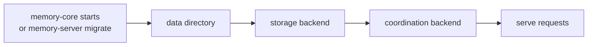

# Versioned schema migrations

[繁體中文](SCHEMA-MIGRATIONS.zh-tw.md)

A release that changes what is stored brings that data up to date itself. memory-core migrates at start-up, so an operator only updates the code and restarts; `upgrade.sh` handles the host side (backup, `.env`). This page explains how migrations are recorded and how to add one.

## Contents

- [1. Where the version lives](#1-where-the-version-lives)
- [2. When migrations run](#2-when-migrations-run)
- [3. Migrations so far](#3-migrations-so-far)
- [4. Adding a migration](#4-adding-a-migration)

## 1. Where the version lives

Every store keeps its own version, so each one is migrated by the code that owns it:

| Store | Version kept in | Code |
| --- | --- | --- |
| Data directory | none; the layout itself (`<data>/instances` vs `<data>/departments`) | `fs::migrate_data_dir` |
| SQLite department `memory.db` | `PRAGMA user_version` | `sqlite/schema.rs` `migrate_department` |
| SQLite `system.db` (local coordination) | `PRAGMA user_version` | `sqlite/schema.rs` `migrate_system` |
| Postgres | `agent_memory.schema_migrations` (one row per step: version, name, time) | `postgres/schema.rs` `MIGRATIONS`, `postgres/db.rs` `migrate` |
| Redis | `{prefix}:schema_version` | `redis/migrate.rs` |

The DDL in `sqlite/schema.rs` and `postgres/schema.rs` always describes the **latest** version. A migration step only turns older data into that shape. A new install runs the DDL and records the latest version without running any step.

## 2. When migrations run

- **At start-up**, before anything is served. A failed step stops the boot with the error, and the version stays at the last completed step.
- **`memory-server migrate`** runs the same steps and exits. It also opens every SQLite department, which the server otherwise migrates on first use. Run it with `docker compose run --rm -T memory-core migrate` to see the result before the service is back.
- **Several replicas.**
  - Postgres steps run under the bootstrap advisory lock.
  - Redis steps run under `{prefix}:lock:migrate`, and the other replicas wait until `schema_version` is reached.
  - SQLite is single-node by design.
- **Old replicas must be stopped first.** A replica of an earlier version cannot read migrated data. The upgrade guide says so for every release with a migration.
- **One way only.** There are no down migrations. Going back means restoring the backup `upgrade.sh` takes (see [UPGRADE.md](../UPGRADE.md)).

## 3. Migrations so far

| Version | Release | What changes |
| --- | --- | --- |
| 1 | 0.3.0 | "instance" becomes "department": • `<data>/instances` → `<data>/departments` • `system.db` column `instance` → `department`, and the same field inside each document • Postgres `agent_memory.instances(instance_id)` → `agent_memory.departments(department_id)` • prompt targets `instance` → `department` • quota `max_*_per_instance` → `max_*_per_department` (keeping the operator's values) • Redis `{p}:pipe:inst:*` → `{p}:pipe:department:*`, and the `instance` field of state documents, queued jobs and dead letters |
| 2 | 0.3.0 | The team role `reviewer` is removed: such members become `member` (SQLite and Postgres; Redis has no step 2) |
| 3 | next | Scenes and personas become append-only versions: every row of `profile_files` is imported into `scenes` / `scene_versions` / `persona_versions` (version numbers kept, scene ids derived from team, agent and path, persona versions that only refreshed the navigation skipped). `profile_files` is kept but no longer written (SQLite and Postgres; Redis has no step 3) |

## 4. Adding a migration

1. Change the DDL to the new shape.
2. Add a step for each store whose data changes:
   - **SQLite**: raise `SCHEMA_VERSION` and add an `if user_version(conn)? < N` block. Put it before the DDL batch if the DDL would fail on the old shape (an index on a renamed column), after it if the step needs the new tables.
   - **Postgres**: append `(N, "what changed")` to `MIGRATIONS` and call the step from `migrate` when `applied < N`. The row is recorded for you.
   - **Redis**: raise `SCHEMA_VERSION` in `redis/migrate.rs` and add an `if from < N` step.
3. **Make each step safe to repeat.** Check before changing anything (`has_column`, `to_regclass`, the key exists), because a step can be interrupted after part of its work.
4. **Test from the old shape.** Write data with the current code, turn it back into the old shape, migrate twice, then read it with the normal adapters. See `sqlite/schema.rs` tests and `tests/storage_migrations.rs` (Postgres and Redis; run them as described in [TESTING.md §2](TESTING.md#2-postgres-and-redis-integration-tests)).
5. Add a row to §3, and an upgrade section to [UPGRADE.md](../UPGRADE.md) when operators must do anything besides restarting.
6. If a setting in `memory-core.yaml` is renamed, add it to `RENAMED_KEYS` in `memory-server/src/config.rs`. If a `.env` setting is renamed, add it to `RENAMED_SETTINGS` in `upgrade.sh`.
