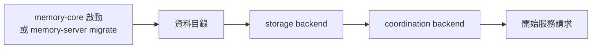

# 有版本的 schema 遷移

[English](SCHEMA-MIGRATIONS.md)

改變儲存內容的版本，會自己把舊資料轉成新格式。memory-core 啟動時就會執行遷移，所以維運人員只需要更新程式碼、重新啟動；`upgrade.sh` 負責主機上的部分（備份、`.env`）。本文說明遷移如何記錄，以及如何新增一個遷移。

## 目錄

- [1. 版本記在哪裡](#1-版本記在哪裡)
- [2. 遷移何時執行](#2-遷移何時執行)
- [3. 目前的遷移](#3-目前的遷移)
- [4. 新增遷移](#4-新增遷移)

## 1. 版本記在哪裡

每個儲存位置各自記錄版本，由負責它的程式碼遷移：

| 儲存位置 | 版本記在 | 程式碼 |
| --- | --- | --- |
| 資料目錄 | 沒有版本，看目錄結構本身（`<data>/instances` 或 `<data>/departments`） | `fs::migrate_data_dir` |
| SQLite 部門的 `memory.db` | `PRAGMA user_version` | `sqlite/schema.rs` 的 `migrate_department` |
| SQLite `system.db`（local coordination） | `PRAGMA user_version` | `sqlite/schema.rs` 的 `migrate_system` |
| Postgres | `agent_memory.schema_migrations`（每個步驟一列：版本、名稱、時間） | `postgres/schema.rs` 的 `MIGRATIONS`、`postgres/db.rs` 的 `migrate` |
| Redis | `{prefix}:schema_version` | `redis/migrate.rs` |

`sqlite/schema.rs` 和 `postgres/schema.rs` 的 DDL 永遠描述**最新**版本，遷移步驟只負責把舊資料轉成這個樣子。全新安裝會直接執行 DDL 並記下最新版本，不會執行任何遷移步驟。

## 2. 遷移何時執行

- **啟動時**，在開始服務之前執行。任何步驟失敗都會讓啟動中止並顯示錯誤，版本停在最後完成的步驟。
- **`memory-server migrate`** 執行同樣的步驟後就結束。它也會開啟每個 SQLite 部門；否則伺服器會在部門第一次使用時才遷移。可以用 `docker compose run --rm -T memory-core migrate` 執行，在服務恢復之前先確認結果。
- **多個 replica**：
  - Postgres 的步驟在 bootstrap advisory lock 之下執行。
  - Redis 的步驟在 `{prefix}:lock:migrate` 之下執行，其他 replica 會等到 `schema_version` 達到最新版本。
  - SQLite 本來就只支援單一節點。
- **必須先停掉舊版的 replica。** 舊版讀不懂遷移後的資料。每個含遷移的版本，升級指南都會寫明這點。
- **只能往前。** 沒有反向遷移。要回到舊版，請還原 `upgrade.sh` 做的備份（見 [UPGRADE.zh-tw.md](../UPGRADE.zh-tw.md)）。
- **拒絕更新的資料。** 儲存端的版本（`user_version`、`max(schema_migrations.version)`、`schema_version`）比程式認得的新時，memory-core 會停止並顯示錯誤，不遷移也不改寫任何東西。沒有這項檢查的話，舊的 SQLite 版本會把 `user_version` 改回去，之後再升級時會在中間寫入的資料上重跑遷移。0.4.0 以前的版本沒有這項檢查。

## 3. 目前的遷移

| 版本 | 發行版 | 改變內容 |
| --- | --- | --- |
| 1 | 0.3.0 | 「instance」改名為「部門（department）」： • `<data>/instances` → `<data>/departments` • `system.db` 的欄位 `instance` → `department`，各文件裡的同名欄位也一起改 • Postgres 的 `agent_memory.instances(instance_id)` → `agent_memory.departments(department_id)` • prompt 目標 `instance` → `department` • 配額 `max_*_per_instance` → `max_*_per_department`（保留維運人員設定的值） • Redis 的 `{p}:pipe:inst:*` → `{p}:pipe:department:*`，以及狀態文件、佇列中的 job 和 dead letter 裡的 `instance` 欄位 |
| 2 | 0.3.0 | 移除 team 角色 `reviewer`：這些成員改為 `member`（SQLite 和 Postgres；Redis 沒有第 2 步） |
| 3 | 0.4.1 | 場景和 persona 改成只追加的版本：`profile_files` 的每一列都匯入 `scenes`／`scene_versions`／`persona_versions`（保留版本號；場景 id 由 team、agent 和路徑推導；只更新了導覽的 persona 版本略過）。`profile_files` 保留但不再寫入（SQLite 和 Postgres；Redis 沒有第 3 步） |
| 4 | 0.4.2 | 新增「沒有向量的 atom」的 partial index `ix_atoms_missing_embedding`，作為補向量的佇列。SQLite 和部門的資料表一起建立；Postgres 和 embedding 欄位一起建立，所以只在開啟 embedding 時才有，並在升級後每個部門第一次被使用時建立。建立方式是交易內的一般 `CREATE INDEX`：`atoms` 很大的部門，第一個請求要等索引建完，期間對它的寫入也會被擋住（Redis 沒有第 4 步） |
| 5 | 0.4.2 | 管理者的遮罩規則：每個部門新增 `meta_redaction_rules` 表（SQLite 和 Postgres；Redis 沒有第 5 步）。沒有要轉換的資料，但記成新版本可以擋住舊版 memory-server：舊版不認得這些規則，會把它們要遮的內容照樣存下來 |
| 6 | 0.4.3 | User key 改存 SHA-256 雜湊：`key_value` 變成 `sha256:<hex>`，文件加上 `key_hint`（最後四個字元），已轉換的列會跳過。Postgres 在 memory-core 啟動時轉換所有部門；SQLite 在每個部門的資料庫第一次開啟時轉換。Postgres 也在登記表 schema 新增憑證稽核紀錄 `agent_memory.audit_events`（SQLite 放在 `<data>/audit.db`，不屬於有版本的資料庫；Redis 沒有第 6 步）。現有的 key 照常可用；舊版 memory-server 無法比對它們 |
| 7 | 0.5.0 | 團隊或使用者層級的遮罩規則（`meta_redaction_rules.doc` 裡的 `team_id`、`user_id`）。不轉換任何資料，但舊版 memory-server 不能在這份資料上執行：它會把這些規則套用到所有團隊，並在儲存時丟掉它們的層級（SQLite 與 Postgres；Redis 沒有第 7 步） |
| 8 | 下一版 | 記錄每個場景由哪些 atom 寫成（`scene_atoms`：一個 atom 同時最多屬於一個場景，以部分唯一索引 `ux_scene_atoms_current` 保證），以及場景可能過期的原因（`scene_stale`），兩張表都在各部門內，隨場景一起刪除。不轉換任何資料：之前寫成的場景沒有 atom 的紀錄，要等 L2 再把 atom 放進去才會有。舊版 memory-server 不能在這份資料上執行：它寫入或刪除 atom 時不會標記場景（SQLite 與 Postgres；Redis 沒有第 8 步） |

## 4. 新增遷移

1. 把 DDL 改成新的樣子。
2. 每個資料有變動的儲存位置各加一個步驟：
   - **SQLite**：調高 `SCHEMA_VERSION`，加上 `if user_version(conn)? < N` 區塊。如果 DDL 遇到舊結構會失敗（例如索引用到改名的欄位），步驟放在 DDL 之前；如果步驟需要新的資料表，就放在 DDL 之後。
   - **Postgres**：在 `MIGRATIONS` 加上 `(N, "改了什麼")`，並在 `migrate` 裡 `applied < N` 時呼叫該步驟。記錄那一列會自動完成。
   - **Redis**：調高 `redis/migrate.rs` 的 `SCHEMA_VERSION`，加上 `if from < N` 步驟。
3. **每個步驟都要能安全地重複執行。** 改動之前先檢查（`has_column`、`to_regclass`、key 是否存在），因為步驟可能只做了一部分就中斷。
4. **從舊結構開始測試。** 用目前的程式碼寫入資料，再把它改回舊結構，遷移兩次，然後用一般的 adapter 讀回來。參考 `sqlite/schema.rs` 的測試和 `tests/storage_migrations.rs`（Postgres 與 Redis，執行方式見 [TESTING.zh-tw.md 第 2 節](TESTING.zh-tw.md#2-postgres-與-redis-整合測試)）。
5. 在第 3 節加一列。如果維運人員除了重新啟動之外還需要做別的事，也要在 [UPGRADE.zh-tw.md](../UPGRADE.zh-tw.md) 加一節升級說明。
6. 如果 `memory-core.yaml` 有設定改名，把它加進 `memory-server/src/config.rs` 的 `RENAMED_KEYS`。如果 `.env` 有設定改名，加進 `upgrade.sh` 的 `RENAMED_SETTINGS`。
